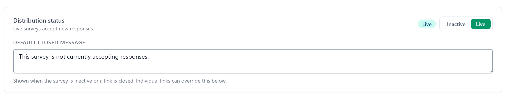

**Distributions** controls how respondents enter a survey and whether it accepts new responses. Survey staff need access to the survey and its distribution controls.

{/* Available with */}
{/* Let Q-bit do it */}

Before you start, save and [publish a survey version](../surveys/publish-a-version), and test the respondent journey. Publishing the survey and making distribution live are separate actions.

Choose how respondents will enter the survey.

- [Share a direct link](./manage-direct-links) for an ordinary shared link or an internal recruitment channel.
- [Invite an email list](./create-a-campaign) using a campaign.
- [Receive respondents from a panel supplier](./connect-a-third-party-supplier) using a supplier connection.

1. Open **Surveys**.
2. Select the survey, then open **Distributions**.
3. Set up the entry method you chose.
4. Enter a **Default closed message**. This is shown when the survey is inactive or a link is closed, unless that link has its own message.
5. Leave the message field to request a save. Check that the message is retained.
6. When the published survey and entry method are ready, choose **Live** under **Distribution status**. Check that the status shows **Live**.
7. For a direct link, expand its row under **Live survey URLs**. If the link is closed, choose **Reopen**. The survey must also be **Live** for a respondent to enter.
8. Test the respondent URL on an approved controlled link with a synthetic survey. Verify the published version and entry settings. Keep test responses separate from customer data.
9. Share the intended URL with the approved audience, or follow the campaign or supplier instructions.

A preview link tests the saved draft and routing. It does not verify the published respondent entry. A respondent URL can create a real response, so use fictional answers and follow your organisation's testing process.

Choose **Inactive** to stop accepting new responses across the survey. To stop just one direct link, open it and choose **Close**. Choose **Reopen** to open that link again. The survey must also be **Live** for a respondent to enter. Distribution controls are separate from the survey draft and publication. A closed or inactive survey can also prevent someone from reopening a saved continuation link. Do not rely on closing a link alone to interrupt a session already open in a respondent's browser.

If a respondent sees a closed message, check both the survey distribution status and the individual link. A link-specific message takes precedence over the default. If the survey content is not the version you expect, review the published version before changing distribution status. If a change fails, read the error and retry before sharing the link.

Once fieldwork begins, [monitor starts and completions](../reports-analysis/monitor-fieldwork).
