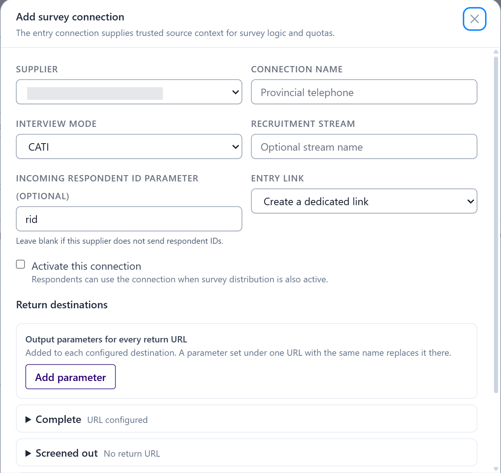

A supplier connection links a survey entry to the supplier’s return destinations for each response outcome. Use it when a supplier recruits respondents and needs outcome returns. Agree the entry ID parameter and return URLs with the supplier before setup. You need access to **Third-party panels** and the survey's **Distributions** page.

{/* Available with */}
{/* Let Q-bit do it */}

## Save supplier defaults

1. Open **Third-party panels** and choose **Add supplier**.
2. Enter the **Supplier name** and choose the **Default interview mode**, Online or CATI.
3. Under **Return destinations**, add common mappings in **Output parameters for every return URL**. For each, enter the supplier's parameter name and choose **External respondent ID** or **Fixed value**. Enter the fixed value when applicable.
4. Expand each outcome: **Complete**, **Screened out**, **Cleaned out**, and **Over quota**. Enter the supplied return URL where needed. Add outcome-specific parameters under that URL if the supplier requires them.
5. Review the supplier defaults and choose **Save supplier**.

Common parameters are added to each configured return URL. They do not create a destination when its URL is blank. An outcome-specific parameter with the same name replaces the common parameter for that outcome. Names are compared without regard to case, so an outcome-specific `RID` replaces a common `rid`. For example, add a common `project` fixed value for every return, then add an outcome-specific `project` if one outcome needs a different value.

The supplier's mode, destinations, and parameters are copied when a survey connection is created. Each connection has its own settings, so later changes to supplier defaults do not update existing connections. A supplier already used by a survey connection cannot be removed from the directory.

## Connect the supplier to a survey

1. Open the survey and select **Distributions**. Under **Supplier connections**, choose **Add connection**.
2. Select the supplier and enter a **Connection name**. Confirm **Interview mode** and, if useful, enter a **Recruitment stream**.
3. Enter the supplier's **Incoming respondent ID parameter**. The initial value is `rid`. This is the name of the parameter on the entry link, not the respondent's ID. The return parameter can have a different name: for example, receive the ID as `supplier_id` and return it as `rid` using **External respondent ID**.
4. Under **Entry link**, choose **Create a dedicated link** or an available non-default direct link. Review the copied common parameters, four outcome URLs, and outcome-specific parameters for this survey, including any study-specific values.
5. Choose **Activate this connection** when ready, then choose **Save connection**. The connection starts inactive; respondents can enter only when the connection and survey distribution are active.
6. Use **Preview return destinations** to inspect synthetic resolved URLs. Use **Preview connection** to test the survey journey without sending a respondent to the supplier. Check complete, screened-out, cleaned-out, and over-quota paths as applicable.
7. Copy the **Entry link** for the supplier once the published survey, connection, and returns have been checked.

The supplier and entry link cannot be changed on an existing connection. After responses exist, the interview mode, recruitment stream, and incoming ID parameter are fixed to preserve attribution. A connection with responses must be deactivated instead of removed.

If the supplier sends no IDs, leave the incoming ID parameter blank. For every configured return URL, remove or override any effective **External respondent ID** mapping. The connection warns when a configured return still requires an ID. For example, an outcome-specific fixed `RID` overrides a common external-ID `rid` for that outcome only. Check all other configured outcomes too. If saving fails, review the reported error, including any parameter names already present in a return URL, and correct the settings before trying again.

A Page Action, normal completion, or quota-full exit can use the originating supplier's return. The effective common and outcome-specific parameters are included in the return URL. Respondents who have already entered keep the routing settings saved with their response. If no return URL is configured for an outcome, the respondent sees a default exit message. See [Screen and route survey respondents](./screen-and-route-respondents) and [Share selected quota progress](./share-quota-progress).

Before fielding, [test supplier entry and return destinations](./test-supplier-returns).
