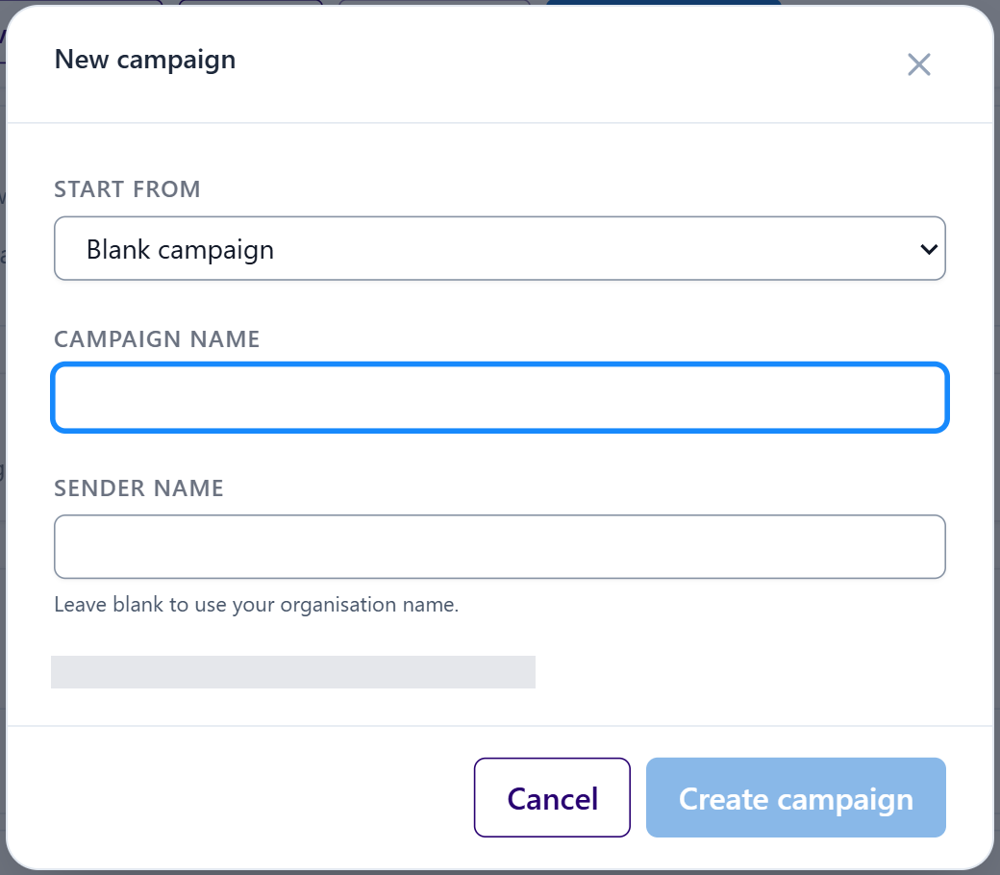

An email campaign invites a sample to a survey and manages follow-up messages. Choose the respondent link mode before adding recipients.

{/* Available with */}
{/* Let Q-bit do it */}

## Create the campaign

1. Open **Campaigns**. You can also start from the survey's **Distributions** tab.
2. Choose **New campaign**.
3. Under **Start from**, choose **Blank campaign** or a saved template.
4. Enter a **Campaign name**.
5. For a blank campaign, enter a **Sender name**, or leave it blank to use the organisation name.
6. Select the **Survey** if it is not already shown.
7. Choose **Create campaign**. The campaign opens on **Overview**.

If **Create campaign** is unavailable, check that a name and survey are selected. If creation reports an error, read the message and resolve it before retrying.

## Choose the respondent link mode

On **Overview**, choose the **Respondent link** mode before adding recipients:

- **Unique link per respondent** gives each recipient a tracked link and connects their response to their contact.
- **Shared link** gives everyone the same link. Responses are counted but are not tied to individual contacts.

Check the selected mode before continuing. It cannot be changed once recipients have been added. Add the sample, prepare the emails, and review the send settings before sending.

For example, choose unique links when reminders must target people who have not completed. Choose a shared link when you do not need to associate responses with individual contacts.

For a tracked campaign, the **Preview URL** tests an isolated copy of the first sample recipient when one is available. For a shared link, the preview has no sample identity. Preview links expire after seven days. Test responses remain separate from live results and are retained until deleted.

## Reuse a campaign

To save a reusable configuration, open an existing campaign and choose **Save as template**. Save any pending edits first. A template copies saved messages, design, sender and footer settings, follow-up timing, and quiet hours. It does not copy recipients, responses, sending history, or launch dates. Review wording, images, fixed links, sample fields, and translations for the new survey.

Continue with [contacts and sample](./prepare-contacts-and-sample), then [design the emails](./design-campaign-emails). Publishing the survey, making distribution **Live**, and creating a campaign do not send invitations. When the survey is published, distribution is **Live**, and the sample and messages are ready, set **Send invite at** and choose **Schedule**, or choose **Send invite now** on the campaign’s **Send** tab. Follow [schedule and send](./schedule-and-send-a-campaign) to review the send plan.

Once respondents begin, [monitor starts and completions](../reports-analysis/monitor-fieldwork).
