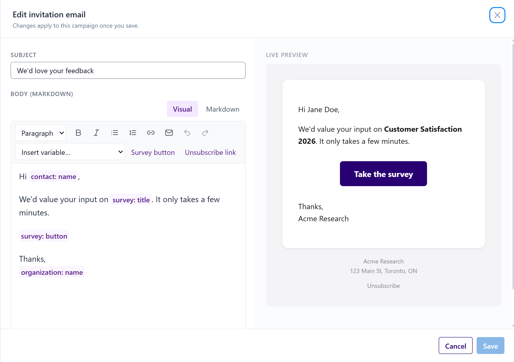

Campaign emails provide the invitation and follow-up messages recipients see in their inboxes. Campaign administrators can prepare their content and appearance before scheduling a send. Start with a campaign and a survey that is ready for testing.

{/* Available with */}
{/* Let Q-bit do it */}

## Set the sender and design

1. Open the campaign and select **Design**.
2. Enter a **Sender name** and, if needed, a **Reply-To email**. Replies go to that address; the sending address is managed centrally.
3. Upload a logo, choose its placement, and set the email and button colours. If an existing logo offers **Prepare current logo for email**, use it to prepare the email-compatible image.
4. Set the **Survey button** label. In an email body, insert the survey button variable to place the button.
5. Select or create a footer address and review the footer text and unsubscribe label. The preview updates as you edit.
6. Choose **Save branding**.

## Prepare the messages

1. Open **Emails**.
2. Choose **Add invitation email**. The invitation editor opens.
3. Review and edit the **Subject** and **Body (Markdown)**. Include the survey link or button using the editor's variables.
4. Review the preview with sample values. Check that the survey link and footer are present.
5. If you changed the message, select **Save**. If you kept the default message unchanged, close the editor with **Cancel**. The invitation appears on **Emails**.
6. When ready to send a test, select the paper-plane control labelled **Send a test email** on the invitation row.
7. Enter approved test addresses in **Send tests to**. You can enter up to 10 addresses separated by commas, semicolons, or new lines.
8. Select **Send test**. Check the confirmation and the result in the recipient's email client.

Add **Automatic follow-ups** as needed. Each is sent once after the preceding email, unless the recipient completes first. A new follow-up starts with a three-day delay; edit the delay to suit the campaign. Add an optional **Thank-you** email for completed responses. Add **On-demand reminder templates** if you plan to choose a separate audience later. These templates do not send automatically.

Use the editor's variables to personalise supported content, such as the contact name, survey title, or imported sample fields.

For example, preview an invitation with a synthetic contact name, then send a test to an approved test address and check the button, footer, and Reply-To in the received email. **Send test** sends an actual test email to those addresses. It is separate from scheduling or sending invitations to the campaign sample.

Review translated survey and campaign wording before sending to respondents in another language. If a test cannot be sent during daily quiet hours, wait until the quiet period ends and send the test again. It is not queued. Once the sample and messages are ready, [schedule or send the campaign](./schedule-and-send-a-campaign).
