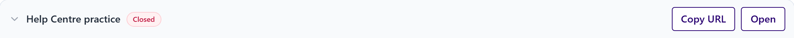
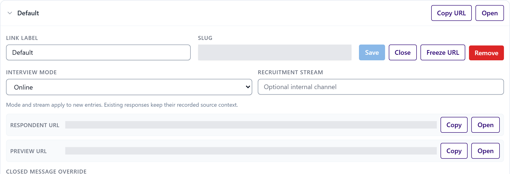
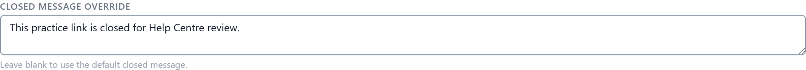
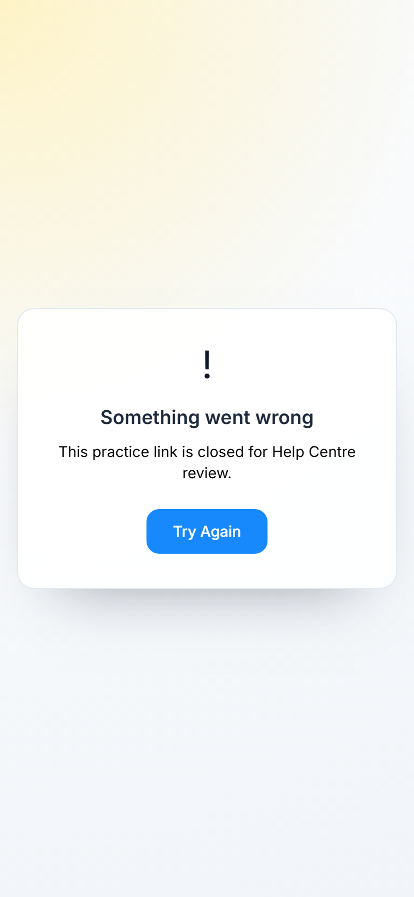
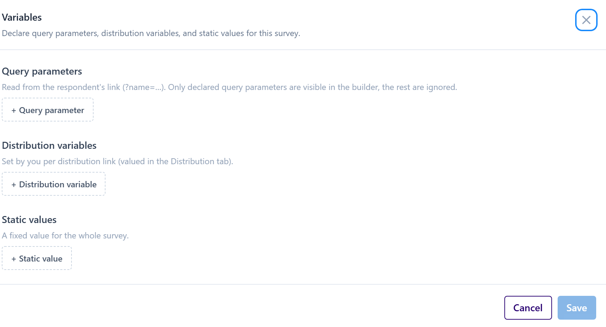

A direct respondent link provides a survey URL that can be shared or used to distinguish recruitment channels. You need a survey and permission to manage its distribution.

{/* Available with */}
{/* Let Q-bit do it */}

1. Open **Surveys** and select the survey.
2. Open **Distributions**.
3. Under **Live survey URLs**, select an existing link, or choose **Add link**. Asker creates a new link immediately with a generated label and slug. A full survey preview creates a link labelled **Default** if the survey had no link.
4. Select the link row to expand its settings.
5. If the label and slug are editable, enter a **Link label** and a **Slug**. The slug forms part of the URL and uses lowercase letters and numbers, optionally separated by single hyphens. It cannot contain spaces or start or end with a hyphen.
6. Choose **Online** or **CATI** under **Interview mode**. If useful, enter a **Recruitment stream**, such as `telephone`.
7. Select **Save** to keep any edits. New responses record the mode and stream; existing responses keep the context recorded when they started.
8. Confirm the survey has a published version and **Distribution status** is **Live**. If the link is closed, select **Reopen**. An open link offers **Close** in its expanded settings.
9. Use **Open** on the link row to open its respondent URL, or select **Copy URL** to copy it. The expanded settings identify the **Respondent URL** and **Preview URL** separately. Check the copied URL before sharing it.

A preview tests the saved draft. Use the respondent URL to check the published entry and for actual fieldwork. Test on an approved controlled link with a synthetic survey and fictional answers: a respondent URL can create a real response. Follow your organisation's testing process, then share the intended respondent URL with the approved audience.

## Control a link

Choose **Close** to stop new entries through that link, or **Reopen** to open it again. Reopening a link does not make an inactive survey live. A closed link can also prevent someone from reopening a saved continuation link. Enter a **Closed message override** if this link needs different wording from the survey's default closed message. Leave the field to request a save, then check that the message is retained. Leave it blank to use the default. The override takes precedence when the link or the survey is closed.

For a non-default link, save the label and slug before choosing **Freeze URL**. This locks the saved URL. A locked or default link cannot have its label or slug edited or be removed. Decide on the URL before sharing it. Closing a link and making the whole survey inactive are separate controls. Do not rely on closure alone to interrupt a session already open in a respondent's browser.

## Set link variables

Use **Manage variables** to declare a distribution variable, then publish the survey after adding or changing that declaration. Enter a value in the expanded link's **Distribution variables** and choose **Save**. The saved link value applies to new responses; responses already started keep the value recorded when they entered.

For example, set a declared `channel` variable to `telephone` on one link and `online` on another. Survey logic can then use the link's recorded value. Test both paths before fielding.

If a link does not open, check the survey's distribution status, the link's **Closed** state, and whether the survey is archived. If a variable does not affect a live response as expected, check that its declaration was published and its value was saved on the intended link.
