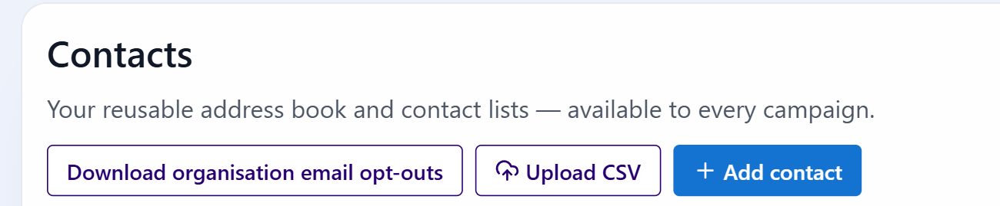

A campaign sample is the group of people selected to receive a survey invitation. Campaign administrators can add people directly or select them from reusable contact lists. Use contact information only for people you are authorised to contact.

{/* Available with */}
{/* Let Q-bit do it */}

## Maintain contacts and lists

1. Open **Contacts**. Add a contact with an email address, name, phone, and optional attributes, or choose **Upload CSV**.
2. A contacts CSV needs an `email` column. `name` and `phone` are optional; other columns become custom attributes. Re-uploading a known address updates that contact.
3. Create a list in **Lists**. Open it to add existing contacts, remove members, or upload contacts directly into the list.

Deleting a list does not delete its contacts. Deleting a contact removes it from the address book and all lists; sent campaigns are unaffected.

## Download organisation email opt-outs

In **Contacts**, open **All contacts** and choose **Download organisation email opt-outs**. Any member authorised to use Asker can download the CSV for their active organisation.

The file has one row per email address with retained campaign unsubscribe evidence or a recorded campaign opt-out time. It includes the earliest retained event time, its campaign ID when available, and whether the address is currently suppressed. An address can appear with current suppression marked `no` if it was reactivated. The file does not include general do-not-contact requests without an explicit email choice, or addresses included only because of bounces, complaints, staff suppression, or SMS opt-outs.

This organisation-wide file is separate from a campaign's **Download unsubscribed** export. Handle either file as contact information and share it only with people authorised to receive it.

## Add the campaign sample

Choose the campaign's respondent link mode before adding anyone. The mode cannot be changed after recipients are added. For a first practice campaign, use an approved test address that you are authorised to contact.

1. Open the campaign.
2. Select **Sample / recipients**.
3. Choose **Add one**.
4. Enter the recipient's **Email** and, if useful, **Name**.
5. Select **Add recipient**.
6. Check that the recipient appears in the sample. In a tracked campaign, a new recipient who has not opened the survey shows **Not started**.

Adding a recipient does not send an invitation. If adding fails, check that the email is valid and the recipient is not already enrolled, then retry.

To add a larger sample, choose **From list** or **Upload CSV**. For a list, choose all contacts or **Only contacts matching attribute conditions**. Combine conditions with **ALL** or **ANY**, review the match count, and add the recipients. For a campaign CSV, include an `email` column. `name` and `account` are optional; other columns become custom sample fields. Review the import result and correct any errors. Already enrolled recipients are skipped.

Search by email, sample ID, or field, and use **Filter sample fields** to inspect the imported sample. In tracked campaigns, **Response status** can narrow the table.

For example, add a list of synthetic contacts and use an attribute condition to select one region. Check the match count before adding the recipients. The sample appears immediately. A response is created when a recipient starts the survey. The sample ID can connect sample records with response exports. Removing a recipient stops further campaign emails to that person.

To download the current filtered view, choose **Download matching sample**. To get all opt-outs recorded through this campaign, choose **Download unsubscribed**; it ignores the current filters and selection. If an import fails, check the required email column and review the reported rows before retrying.
