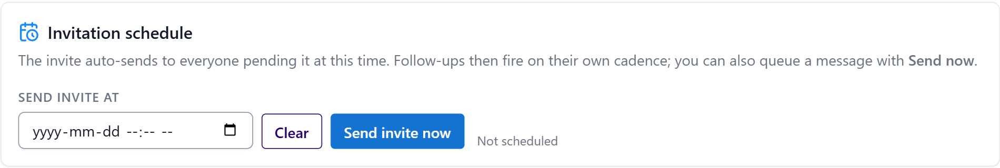
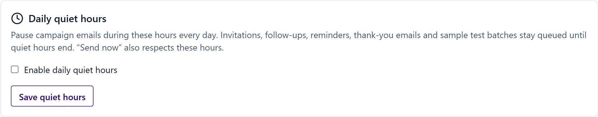

The campaign **Send** tab schedules invitations and shows the automatic email sequence. Before sending, publish and activate the survey, add the intended sample, and review the invitation, links, branding, and follow-ups. If SMS is available in your organization, follow [Send a campaign invitation by SMS](./send-an-sms-invitation).

{/* Available with */}
{/* Let Q-bit do it */}

## Schedule an invitation

1. Open the campaign and select **Send**. If no invitation exists, add one on **Emails** first.
2. Review the send plan and its **Pending** count. This is the group waiting for the invitation.
3. Under **Invitation schedule**, enter **Send invite at** in your local time.
4. Choose **Schedule**. Check the displayed **Currently** time and the scheduled invitation in the send plan.
5. Open **Overview** to monitor **Sent**, **Queued**, **Failed**, and **Cancelled**. A scheduled or queued invitation is not yet recorded as sent. Quiet hours can delay delivery.

To queue the invitation immediately instead, choose **Send invite now**. A message's separate **Send now** action queues it for its currently pending contacts and advances them in the sequence. These are real campaign invitations. Check **Overview** for the resulting delivery status. If a send is uncertain, check the send plan and delivery totals before retrying.

A campaign marked **Sending complete** has finished its configured sequence; it can still be used for targeted reminders. A separate test email checks the message but does not send the campaign invitation to its sample.

## Test with a small batch

Under **Test batch**, choose a number and either the first contacts by order added or a random selection. Review the confirmation and choose **Send test batch**. This is a real invitation to those contacts, and they continue through the automatic follow-ups. Other contacts remain pending until the invitation is scheduled or sent. For example, a batch of five sends actual invitations to five selected contacts; use approved test recipients when rehearsing.

## Set quiet hours and an end date

Enable **Daily quiet hours** to pause email every day. The suggested hours are 20:00 to 09:00 in the browser's time zone. Choose a valid time zone and different start and resume times, then **Save quiet hours**. Invitations, follow-ups, targeted reminders, thank-yous, and test batches stay queued until the pause ends. **Send now** also respects quiet hours.

Set an optional **Campaign end date** separately and choose **Save end date**. Invitations, follow-ups, and targeted reminders stop after this cutoff. Completion-triggered thank-you emails remain eligible, subject to quiet hours.

## Cancel or reopen

On **Overview**, choose **Cancel campaign** to cancel pending emails. Emails already sent cannot be recalled. To permit editing and additional manual reminders later, choose **Reopen for reminders**. Old schedules and cancelled deliveries do not restart automatically. Check the send plan and delivery totals before retrying an uncertain send, and use [targeted reminders](./send-targeted-reminders) for a chosen audience.
