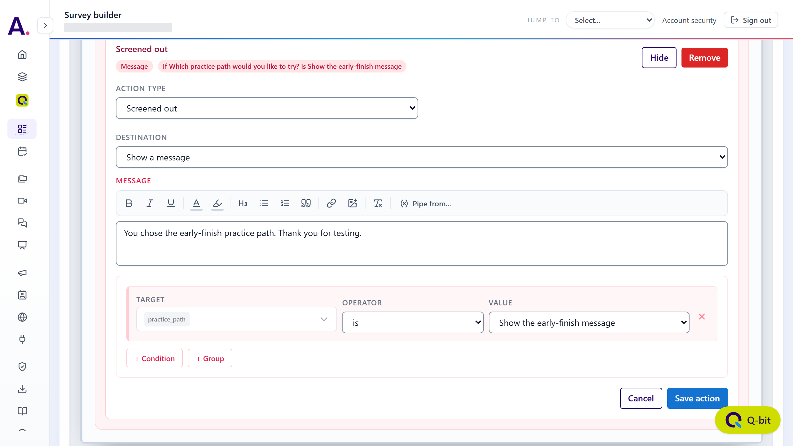
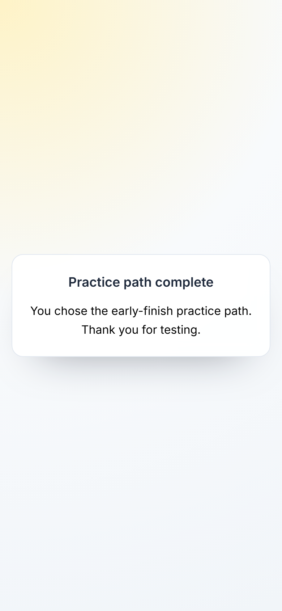

A page action routes a respondent after they submit a survey page. Survey programmers can use actions to jump to another page or end a response with a specified outcome. Test each path with synthetic answers before publishing.

{/* Available with */}
{/* Let Q-bit do it */}

1. Open the survey builder and find the page after which the action should run. Under **Page actions**, choose **Add page action**.
2. Choose an **Action type**. **Jump to page** continues the survey at a selected page. **Complete**, **Screened out**, **Cleaned out**, and **Over quota** end the response with that outcome.
3. For a terminal action, choose a **Destination**:
   - **Normal survey handling** uses the respondent's entry connection for a supplier return or the survey's completion handling for other respondents.
   - **Originating supplier** uses the return destination for the respondent's own supplier connection and outcome.
   - A named active connection uses that connection's return for the outcome. Use a connection condition so the action applies to respondents from that connection.
   - **Show a message** displays the message you enter. **Custom URL** redirects to the URL you enter.
4. Set the conditions in the logic editor and choose **Save action**. Add and review any other actions needed for the page.
5. At the end of the builder, configure **End Page** for respondents who reach the final page without a matching action. Save, test the complete routes, and publish the survey version when ready.

Actions are evaluated in their listed order, and the first matching action runs. If none matches, the survey continues to the next visible page. Test overlapping conditions as well as a case where no action matches.

For example, a screening answer can lead to **Screened out** with a message for ordinary respondents. A supplier connection can instead return its respondents to the supplier's screened-out URL. If an originating supplier or named connection has no return URL for the outcome, the respondent sees a default exit message.

## Pass values to a custom URL

For **Custom URL**, enter the destination and use **Add param** to add each parameter. Choose **Reference** for an available answer or variable, or **Static** for a fixed value. Add an optional fallback for an empty value. Answer options pass their stored values, not their labels. Only include information the destination needs.

In a survey preview, a redirect outcome shows the resolved URL without opening it. Check that the destination and values are correct using synthetic answers. A live response follows a valid redirect. If a selected supplier connection is unavailable or inactive, choose an active connection before saving. Automatic quota rejection is configured separately under [Quotas](./set-and-monitor-quotas).
