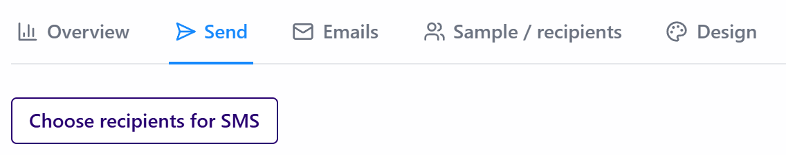
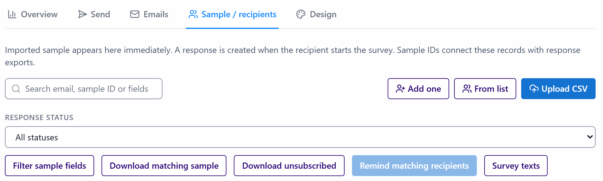

A campaign SMS invitation sends recipients a survey link by text message. When SMS is available and activated for your organization, you can send invitations by SMS before configuring any campaign email.

{/* Available with */}
{/* Let Q-bit do it */}

## Before you send

Publish the survey, make its distribution **Live**, and check that the campaign link is open. Your organization needs a configured SMS sending number. Under **Sample / recipients**, use **SMS permission** to record each recipient’s confirmed phone number, SMS language, and consent reference.

## Choose recipients, review, and send

1. In your campaign, open **Send** and select **Choose recipients for SMS**. This shortcut opens **Sample / recipients** for the same campaign. The message about adding an invitation on the **Emails** tab applies to email.

   

2. Select the intended recipients and open **Survey texts**.

   

3. Choose **Invitation**, the message language, and a **Sending number**. Enter your **Message**. Include `{{survey_link}}` exactly once, with spaces or a line break separating it from other text. Keep punctuation away from the placeholder.
4. Select **Review texts**. Review the messages and check the sender, survey link, opt-out instruction, and eligible recipient count. Check the reasons for any exclusions, such as missing permission, an opted-out number, or a language mismatch.
5. Select the send button with the eligible count, such as **Send 1 text**, to queue the messages. Check **Recent SMS delivery status** to follow delivery.

For a follow-up text, choose **Reminder** in **Survey texts**. Reminders require individual survey links. See [Schedule and send a campaign](./schedule-and-send-a-campaign) for email.
