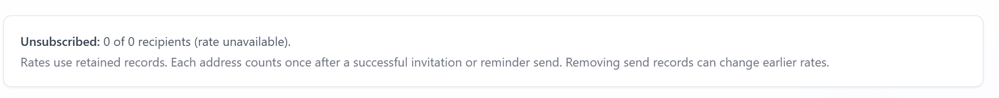
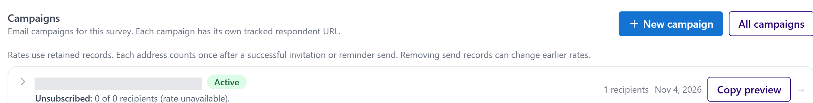

A targeted reminder sends a chosen campaign message to eligible, unfinished recipients. It requires a campaign with unique respondent links. Shared anonymous campaigns cannot identify individual responses and do not offer targeted reminders. Add a reminder template on **Emails** first.

{/* Available with */}
{/* Let Q-bit do it */}

1. Open the campaign and select **Sample / recipients**.
2. Search, choose a **Response status**, or use **Filter sample fields** to match **ALL** or **ANY** conditions. Conditions can compare contact and sample fields, including whether a field is set.
3. Select individual rows, or leave rows unselected to target all matching recipients. Choose the button showing the selected recipient count, or choose **Remind matching recipients**.
4. Choose an email template and review its content and Reply-To. Leave **Send at** blank to queue now, or enter a date and time in your local time.
5. Choose **Preview eligible audience**. Review the matched, eligible, and excluded counts, then confirm the send or schedule.

For example, filter for one region, preview the audience, and compare the matched and eligible counts before confirming. Only invited recipients who have not completed are eligible. The confirmed scheduled audience is fixed, and eligibility is checked again before delivery. A targeted reminder keeps the original personal survey link and does not restart the automatic follow-up sequence. Quiet hours can delay delivery.

On **Send**, review **Targeted reminder history** for the batch and its delivery counts. If a batch is still queued or sending, **Cancel remaining** stops the unsent portion; sent emails cannot be recalled. If a request times out, check history before trying again. Keep the same dialog open to retry the same batch if needed, rather than starting a second one.

Recipients can use the unsubscribe link in the email and confirm their choice on the unsubscribe page. In **Sample / recipients**, **Download unsubscribed** includes all opt-outs recorded through the campaign, regardless of the current search, filters, selected rows, or page. It is separate from **Download matching sample**.

## Read campaign unsubscribe results

Open the campaign's **Overview** to see **Unsubscribed**, or open the survey's **Distributions** tab and find the email campaign. Each shows the recorded unsubscribe count, the qualifying recipient count, and the rate when it can be calculated.

The qualifying base counts each email address once after an invitation, follow-up, or reminder is successfully sent, even if that address received more than one message. Provider acceptance counts as a successful send. The rate compares the number of distinct addresses with recorded campaign unsubscribes with that base. With no qualifying sends, the rate is unavailable. If send or opt-out records are incomplete, Asker shows the counts it can support and leaves the rate unavailable. The unsubscribe link identifies the campaign, not which individual message led to an opt-out.

The figures use retained records. Removing a recipient or a sent message, or changing a message's role, can change earlier figures. Staff previews are excluded, but a successful real test-batch invitation counts.

If the reminder control is unavailable, check that the campaign uses unique links, that it has eligible recipients, and that it is not cancelled. A cancelled campaign can be reopened from **Overview** for manual reminders.
