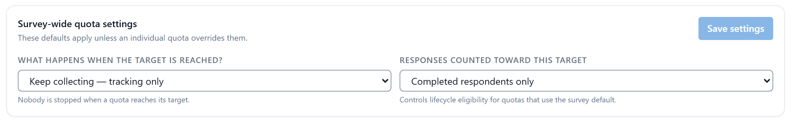
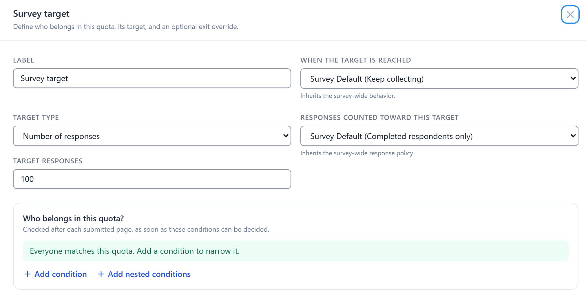
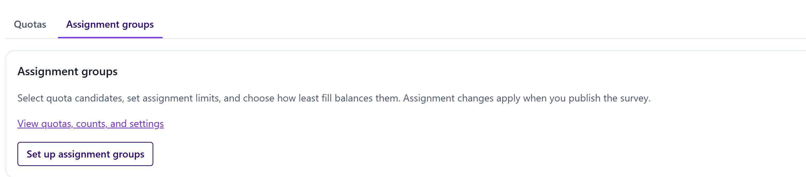

A quota tracks or limits responses from a defined group against a target. Open the survey's **Quota** area, then select the **Quotas** tab. Decide the target, membership conditions, and behaviour at capacity before fielding.

{/* Available with */}
{/* Let Q-bit do it */}

Changes saved on the **Quotas** tab affect current quotas immediately. A simple tracking or stopping quota is ready once you save it. See [Manage quotas and weights](../surveys/stage-quotas-and-weights) when you need to coordinate changes with a new survey version.

## Set survey-wide defaults

Under **Survey-wide quota settings**, choose what happens when a target is reached:

- **Keep collecting** (tracking only) counts matching responses without stopping them. This is the default.
- **Let in-progress respondents finish** stops new matches while recent active respondents can finish. Set the **In-progress hold timeout (minutes)** from 1 minute to 7 days. The default is 30 minutes.
- **Stop at the target** stops matching respondents when the target is reached.

Choose whether the target counts **Completed respondents only** or **In-progress and completed respondents**, then select **Save settings**. Individual quotas can override these defaults. Expand **Default full-quota exit** to set the message or destination used when a stopping quota has no exit override, then select **Save default exit**.

## Add a quota

1. Select **Add quota**. Enter a **Label** and select **Target type**: **Number of responses** or **Percentage of total target**. A new quota starts at 100 responses and inherits the survey defaults.
2. Under **Who belongs in this quota?**, build the conditions for the group. For example, a regional quota can match a specific region answer. Conditions are checked after each submitted page as soon as they can be decided.
3. If needed, override **When the target is reached** and **Responses counted toward this target**. A quota that stops respondents needs a positive target; a percentage also needs **Total target responses**.
4. For a stopping quota, optionally choose **Use a different exit for this quota** and configure its message or destination. Otherwise, the **Default full-quota exit** applies. Tracking-only quotas continue collecting.
5. Select **Save quota**. An ordinary quota is ready at this step and counts qualifying responses according to its own rules. Repeat for other independent quotas, and test the rules and exits with synthetic responses.

## Set up least-fill quotas

To balance credit across eligible quotas, open **Quota → Assignment groups**. Under **Quotas to select from**, choose the quotas to balance. Set **Assign after page**, **Minimum**, and **Maximum**. Under **Least fill by**, choose **Percentage of target** or **Response count**. Save the draft and [publish the group](../surveys/set-up-quota-assignment-groups#review-and-publish).

Asker selects eligible quotas when the respondent submits the trigger page. Both methods take active reservations into account. On completion, only the selected quotas in that group receive credit. This works when everyone answers the same questionnaire. See [Set up quota assignment groups](../surveys/set-up-quota-assignment-groups) for the full workflow and a worked example.

## Generate and monitor quotas

Under **Generate quotas**, select a single-select, scale, or NPS **Seed question**, and choose **Generate even quotas** or **Generate blank quotas**. Choose count or percent, edit groups and limits, and combine selected groups where needed. Generated percentage limits must add to 100%. Generation supports up to 200 cells.

Applying the generated set changes current quotas. If quotas already exist, confirm **Replace existing quotas?** only after reviewing the rows. If applying fails, inspect the current table before trying again, because some changes may already have been made.

The quota table shows each rule, status, target, and progress. Search labels or conditions, filter by status, or edit a target in the table. **Refresh fills** recounts existing responses. **Counting only** means a tracking target, **Places held** identifies capacity held by in-progress respondents, and **Target reached** indicates a full target.

For example, a quota with a target of 100 and **Keep collecting** can continue beyond 100. Changing its enforcement to **Stop at the target** can send matching respondents to the full-quota exit. Review the consequences before changing a live quota. For help reading the table, see [Understand quota targets and counts](./understand-quota-counts). To give a supplier an aggregate view, [share selected quota progress](./share-quota-progress).
