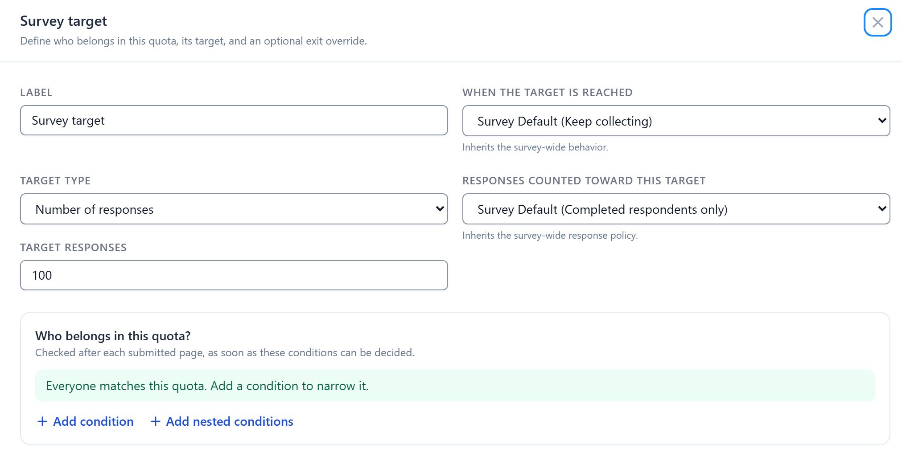

The **Quotas** table shows progress against each current survey target and how the target is counted. Open the survey's **Quota** area, then select the **Quotas** tab. You need access to the survey's quota settings to review its rules and behaviour.

{/* Available with */}
{/* Let Q-bit do it */}

## Read the table

- **Who matches** summarises the quota's conditions. Open the row to inspect the full rule and any response-counting override.
- **When full** shows whether the row uses the survey default or its own enforcement setting.
- **Target** is the count or percentage selected for the row. For a percentage target, the table also shows the effective response count.
- **In progress**, **Completed**, and **Other exits** show separate response counts. The row's counting policy determines which responses count toward its target. Do not add every displayed count together as though each contributes to the target.
- **Remaining** and **Achievement** show the progress reported for that quota. Review them with the target and the row's rule.

For example, if a row counts completed respondents only, check the **Completed** figure against its target rather than adding the displayed in-progress and other-exit counts.

The status can be **Accepting**, **Places held**, **Target reached**, or **Counting only**. Places can be held by in-progress respondents. **Counting only** identifies a tracking quota that continues collecting after its target. The survey-wide **In-progress hold timeout (minutes)** controls how long an inactive respondent keeps a place when the setting to let in-progress respondents finish is used.

For quotas used in an [assignment group](../surveys/set-up-quota-assignment-groups), matching an eligibility rule does not by itself give that quota credit. The respondent must also be assigned to it. Active assignments can reserve capacity while the respondent is in progress, and completed qualifying responses fill the selected targets. **Refresh fills** recounts responses; it does not choose new assignments for respondents who already have saved selections.

## Review or change a target

1. Search by label or conditions, or filter by status.
2. Open the row to review its membership rule, response policy, enforcement, and exit. Check whether each setting uses the survey default or an override.
3. If the target needs to change, edit it in the table and leave the field or press Enter to save it immediately. To discard an uncommitted edit, press Escape. Review the updated target and progress, and check for any save error.
4. Select **Refresh fills** to recount existing responses if the figures need to be refreshed. Check any error before relying on the result.

For example, a target of 100 with tracking only can continue counting beyond 100. A stopping quota can send matching respondents to its configured full-quota exit when capacity is reached. Changing a current target or enforcement rule takes effect when saved and can affect people already taking the survey. Review the rule and exit before saving. Use **Assignment groups** to prepare definitions for publication. Ordinary changes to the counts leave those definitions intact.

See [Set and monitor survey quotas](./set-and-monitor-quotas) for creation and generation, and [Share selected quota progress](./share-quota-progress) for an aggregate audience view.
