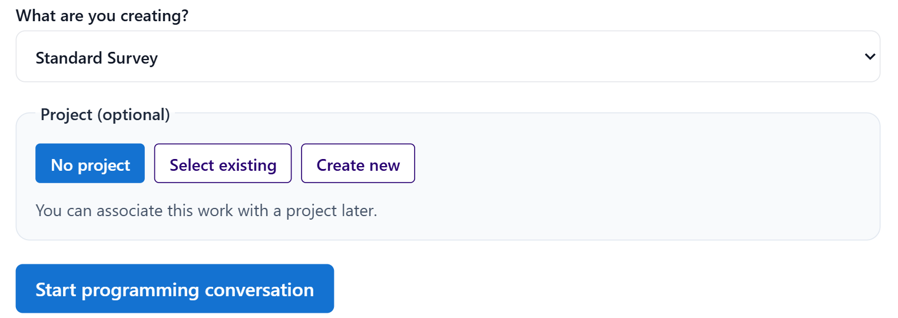

Q-bit can use a brief and your instructions to prepare a draft research setup. You need access to Q-bit and the Project or Session Group where you want to work. Review the draft in its normal editor before using it.

{/* Available with */}
{/* Let Q-bit do it */}

## Create a draft from a brief

1. On the Q-bit page, choose **Create a setup**, or choose **Text to Programming** where it is offered.
2. Under **What are you creating?**, choose the type of setup. Select the Project or Session Group when requested, then choose **Start programming conversation**.
3. Describe the audience, purpose, and requirements. If you have a brief or guide, open **Inputs** and choose **Add source file**. Q-bit uses extracted text, so provide written instructions for information that appears only in images or scanned pages. Choose **Send**.
4. Review the proposed setup, source coverage, assumptions, and questions. Ask for revisions in the conversation if needed. Compare the proposal with your source, including anything that did not extract clearly.
5. Choose **Open draft** or **Choose destination and open draft**, as shown. Check the destination, choose **Review import**, and review the effects before choosing **Create draft**. A new Focus Group or Bulletin Board needs a Session Group. A Registration can use a Session Group or a Project.
6. Open the new draft in its normal workspace. Review its wording and configuration, then save and test it before publishing or opening it.

For example, describe the research objectives and audience for a Focus Group, attach a discussion brief, and review each proposed prompt before creating the draft. Continue with [the Focus Group guide and materials](../sessions/focus-groups/prepare-guide-and-materials), [the Bulletin Board study flow](../sessions/bulletin-boards/build-the-study-flow), or [the Registration form](../registration/write-and-style-the-form). For Surveys, see [Draft a survey with Q-bit](../surveys/draft-a-survey-with-q-bit).

Creating a draft does not publish a study, open registration or fieldwork, invite people, or send messages. Those actions use the controls in the study workspace.

## Change an existing setup

Open the study's Q-bit panel or its programming entry and ask for the change. Proposals are based on the saved setup. **Context details** shows whether the request also includes unsaved details from the current screen. Those details are not saved by asking Q-bit. Review the target and proposed groups, open **Compare before and after**, and select the changes to accept or decline. If related changes are needed for a valid result, include them or ask Q-bit to revise the proposal. See [Use Q-bit on the current screen](./use-q-bit-on-the-current-screen).

- **Focus Group:** Before the session starts, review guide and private preparation changes. Choose **Accept selected to preparation** to save selected changes. Guide changes create a guide override for that Focus Group; changes to notes alone retain the shared guide.
- **Bulletin Board:** The study flow must be editable to accept changes. Choose **Accept selected to Draft**. The published participant version remains unchanged until you publish the flow separately.
- **Registration:** Form changes require an unused draft campaign. Choose **Accept selected to Draft**, then review the form in Registration. Q-bit can also draft an email for an open campaign using a separate review workflow. See [Manage registration email templates](../registration/manage-registration-email-templates).

If the saved setup changes after a proposal, request a fresh proposal before applying. If a decision is interrupted, use **Retry this decision** to recover the same result. Check your access and the study's current status if changes cannot be applied.
