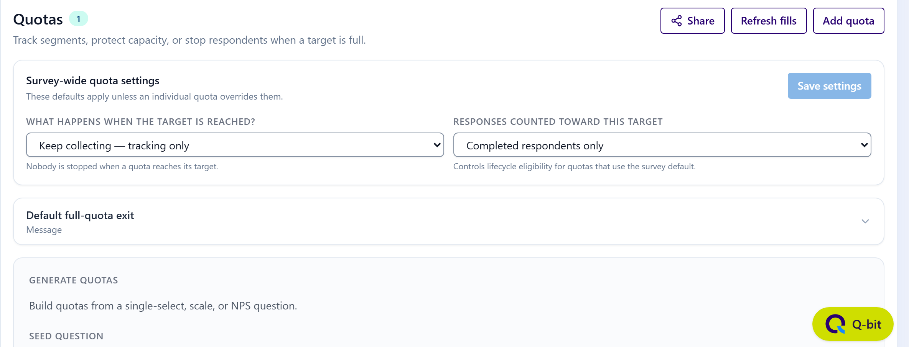
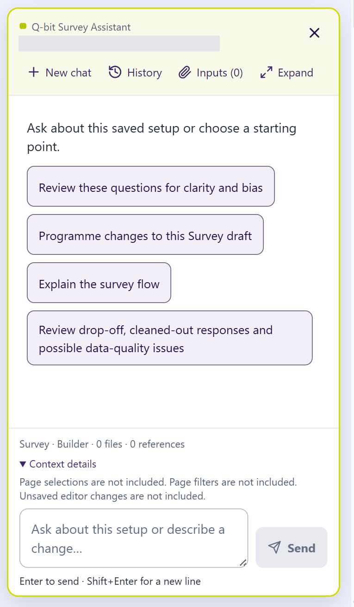

The Q-bit assistant helps you ask questions while working in Asker. You need access to Q-bit and to the research you ask about.

{/* Available with */}
{/* Let Q-bit do it */}

## Open Q-bit

1. Open the survey or other research page you want to ask about.
2. Select the lime **Q-bit** button in the lower-right corner. On a narrow Survey Builder screen, look for the **Q** icon. The assistant opens alongside the page.

   

3. To check the subject of the request before you type, open **Context details** beside the composer. Use **Inputs** to review source files, then choose **Back to conversation**.

## Review context and ask

1. Check **Context details** for the included page, selections, filters, and unsaved details. The context varies by screen. The request leaves unsaved changes in the editor.
2. Enter a question and choose **Send**. For example, on a survey's Responses page, ask “How many responses have completed so far?” Review the answer and cited sources, including the source version. A source link may open a current item that has changed since the cited version.
3. Choose **Expand** to continue the same programming conversation in the full workspace with your unsent prompt. Use **History** to return to a conversation or **New chat** to start another for the current subject. **New unrelated chat** lets you choose different research. Closing the panel or dismissing a **Chat activity** notice does not cancel a run or delete its conversation.

Looking up another study does not change the current editing destination. You can switch Survey tabs with the panel open. An unsent prompt is kept in the current tab and can be lost on reload; a saved conversation can be reopened from **History**. The central Q-bit page has **History** for both **Analysis** and **Text to Programming**. From a programming workspace, choose **All Q-bit chats**.

For example, on a survey's Responses page, Q-bit can use aggregate fieldwork counts and quality flags. To include individual answers, select one to five responses, open **Inputs**, and select **Include answers from selected Survey responses for this request**. Those answers, including written answers, may be sent to the A.I. provider. Response status and quality flags may be included without selecting this option. The choice resets for the next request or if the selection changes. A retry uses the original request and choice.

To let Q-bit read accessible Focus Group transcript text, open **Inputs** and select **Allow Q-bit to read Focus Group transcripts for this request**. Accessible transcript text may be sent to the A.I. provider. This choice resets after sending; an exact retry keeps the original choice. Finding a study or its saved transcript versions is separate from reading transcript text.

The panel can find Bulletin Board snapshots, but it cannot read their written answers or discussion text through that lookup. For those texts or broader work with captured data, use [Q-bit Analysis](../reports-analysis/start-qbit-analysis).

## Review a proposed change

Q-bit can propose supported changes, such as a Survey name, Project description, Bulletin Board preparation notes, or organisation QA Rules. You need permission to change the target; Project changes also require Portal staff access. A proposal does not apply itself. Open the review, check the target and **Compare before and after**, and select the changes you want to decide on. Confirm only when the proposed values are correct, or choose **Decline selected**. Publishing, invitations, and live controls remain separate actions in the study.

QA Rules proposals use the saved organisation rules. Save or discard unsaved edits before confirming. If the original request was made while the form had unsaved changes, request a fresh proposal after resolving them. Survey draft changes also require editing access and a saved draft. See [Review Q-bit changes to a survey](../surveys/review-q-bit-survey-changes).

If a decision is interrupted, use **Retry this decision** to check the same result. If access or the underlying record has changed, review the current state before trying again.
