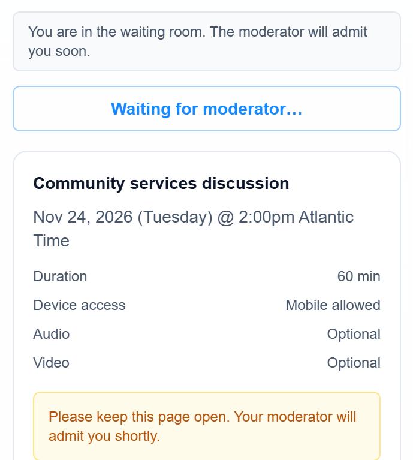
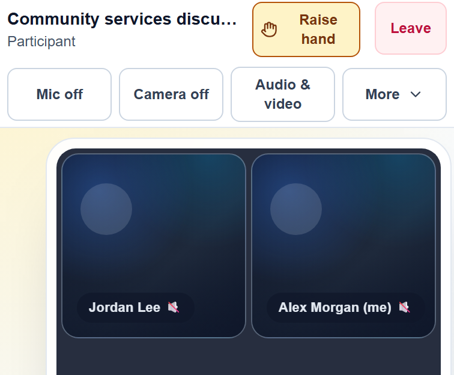
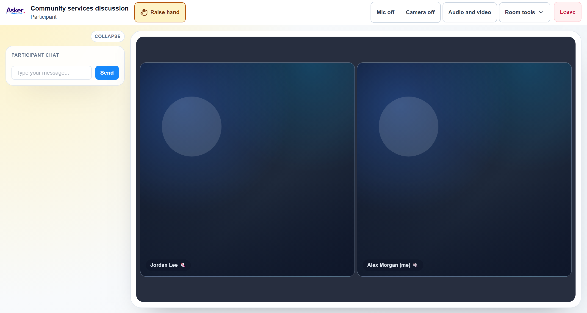

A Focus Group link takes you to a live discussion with the research team and other participants. Open the personal link from the team, and keep it private. The joining page shows the session time in your browser's time zone and, when the waiting room is open, the device requirements and any instructions from the team.

{/* Available with */}
{/* Let Q-bit do it */}

1. When the waiting room opens, check your **Display name**, microphone and camera selections, and camera preview. Allow browser access when prompted. Use the private audio test and watch the input meter while you speak.
2. Choose **Enter room** when you are ready. This requests admission and lets the moderator know you are waiting. **Waiting for moderator…** confirms the request.

   
3. Keep the page open. Once the moderator admits you and the main session is live, the room opens automatically. If you are approved before a moderator enters the main room, keep waiting and follow the message on the page.

   *Example room on a phone with fictional participants*

   

   *Example room on desktop with fictional participants*

   
4. In the room, use **Mic on** or **Mic off** and **Camera on** or **Camera off** to control your devices. Use participant chat to send a message and follow the moderator's shared materials. Participants, moderators, and observers can read participant chat.

Some sessions require audio, video, a desktop, or a minimum screen width. If your device does not meet the requirements, the page explains what is needed. Contact the research team if you cannot meet them or need help with participation.

If a recording starts, the room shows a notice. Ask the research team if you have questions about consent or the recording. Choose **Leave** and confirm when you are ready to leave. This does not end the session for everyone. If you are disconnected, reopen the same personal link.

## Related tasks

- [Fix joining and device problems](./fix-joining-and-devices)
