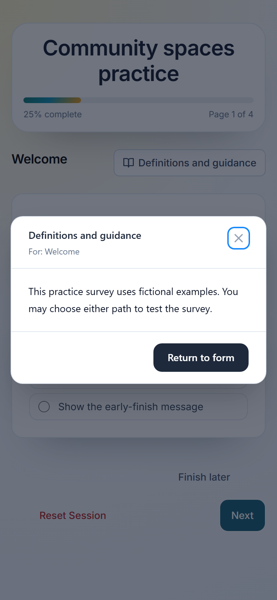

Survey guidance provides additional instructions for a page or question, and keyboard controls help you move through the form. The controls available depend on the survey.

{/* Available with */}
{/* Let Q-bit do it */}

## Open definitions and guidance

If you see **Definitions and guidance**, select it to open the additional instructions. Scroll through the content, then choose **Return to form** or press Escape to close it. Your form remains open, and the action returns focus to the guidance control.

## Answer and review

Use Tab and Shift+Tab to move between available controls. The focused standard choice has a visible indicator. Follow the question's instructions to select or enter an answer. For a ranking question that provides ranking controls, you can select an item and use **Up**, **Down**, and **Remove** instead of dragging.

For example, if a required question is empty, choose its entry in the error summary, answer it, and try **Next** again.

When a page needs corrections, an error summary appears. Select a question in the summary to move to its control, make the correction, and choose **Next** again. If a survey offers a language selector, choose the available language that works best for you.

If you cannot use a control or need another way to participate, contact the survey sender. Avoid sending private answers or a continuation link unless you intend the recipient to have them. For connection and save problems, see [Get help with a survey link or saved progress](./survey-link-and-save-help).
