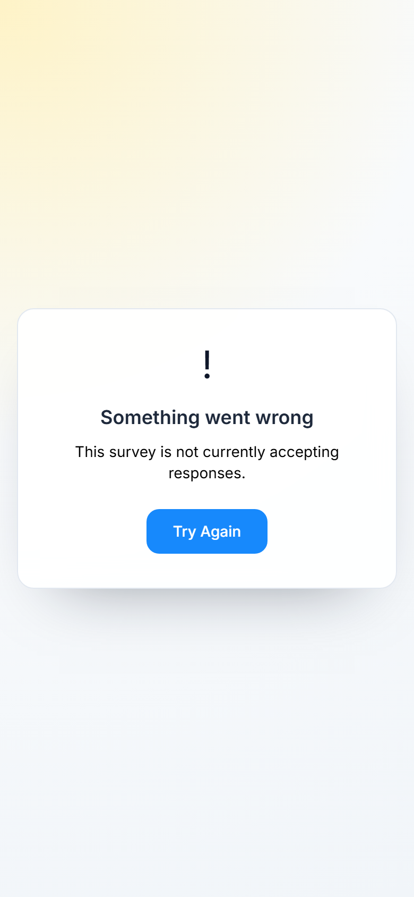
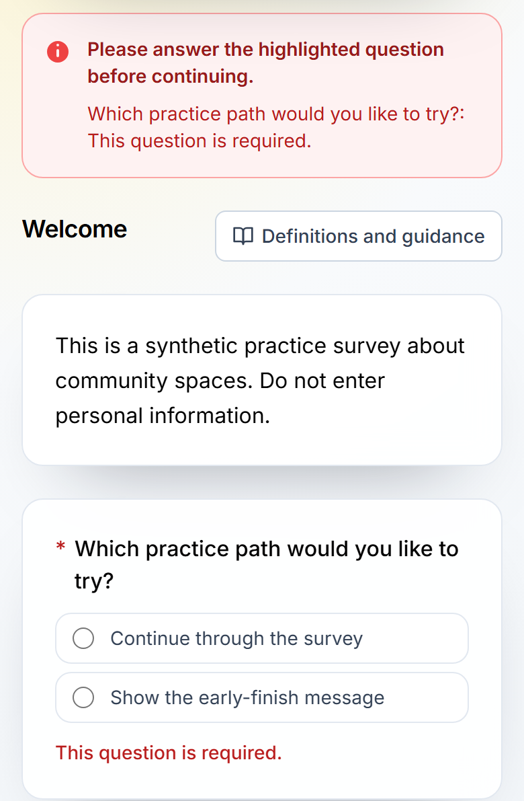

Survey link and save messages can help you resolve problems opening a survey or continuing your response. Use the message on the page to decide what to do next, and keep your survey and continuation links private.

{/* Available with */}
{/* Let Q-bit do it */}

## The link is closed or unavailable

Check that you opened the complete link from the invitation. If the page offers **Retry**, try it. If the survey is closed, the link has conflicting information, or it remains unavailable, contact the sender and ask for help or a new link. Do not send a private continuation link to someone who should not have access to your response.

## A page asks you to correct an answer

After you choose **Next**, an error summary can identify questions that need attention. Select a question in the summary to go to it, correct the highlighted entry, and try **Next** again. Some questions require an answer or a value in a particular format. Read the message beside the question for the requirement.

## Finish later did not save

If **Finish later** reports a problem, check the highlighted entries and your connection, then try again. When saving succeeds, a dialog shows a private link. Use **Copy link**, or select and copy the displayed link if your browser blocks automatic copying. Keep it somewhere safe and use it to continue later.

## A submission could not be confirmed

If Asker asks you to select **Continue**, use it when it is available. If the control is unavailable or the retry fails, keep the page open and contact the survey sender before changing your answers or starting over. Describe the message and keep your answers and private link to yourself.

**Back**, **Finish later**, and **Reset Session** are not offered on every survey. Reset starts a new session, so do not use it merely to retry a failed save. See [Take, resume, or restart a survey](./take-and-resume-a-survey).
