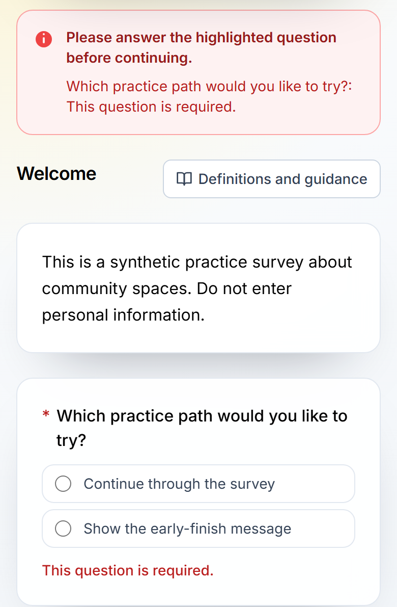
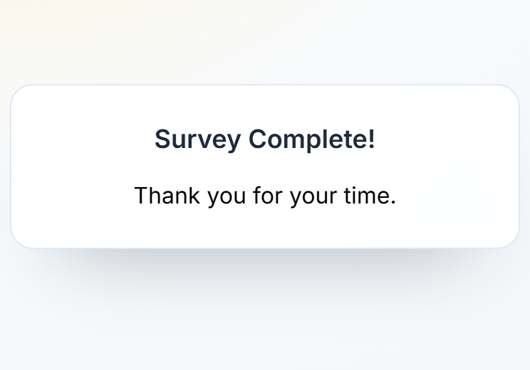

A survey link lets you answer questions and submit your response. Open the link you received and follow the questions on each page. If a language choice is available, select your preferred language. You do not need an Asker account to use a survey link.

{/* Available with */}
{/* Let Q-bit do it */}

## Answer and submit

1. Open the survey link you received. If a language choice appears, select your preferred language.
2. Answer the questions on the page.
3. Choose **Next** to submit the page.
4. If an error appears, read the message and correct the indicated answer. Choose **Next** again.
5. Continue through the survey. At the end, it may show a completion message or return you to the organisation that invited you.

Some surveys provide **Back** to return to a previous page. If you changed answers on the current page, Asker warns you that going back will discard those unsaved changes. If you see **Definitions and guidance**, open it for additional instructions and choose **Return to form** when finished.

## Finish later

If **Finish later** is available, choose it and wait for the save to complete. When the dialog appears, use **Copy link** and keep the private continuation link somewhere safe. If copying is blocked, select and copy the displayed link manually. Open that link later to continue your response, including on another device. Anyone with the link can continue your response, so do not share it with someone else. If saving fails, check the message and connection, correct any highlighted input, and try again before leaving. If the continuation link is closed or unavailable, contact the sender for help. Access depends on the survey and link still being open.

## Restart

Some surveys offer **Reset Session**. After you confirm, it starts a new response from the beginning. The earlier response is not erased by this action. Use it only if you intend to start over; it may not be available for your link. If reset fails, follow the message and try again.

If a link is closed, invalid, or unavailable, contact the sender for help or a new link. If Asker says a submission could not be confirmed, select **Continue** if it is available. If the control is unavailable or the retry fails, keep the page open and contact the sender before changing answers or restarting. Describe the message. Keep your answers and private continuation link to yourself.

## If you need help

If a link will not open, check that you copied the complete link and choose **Retry** if offered. Contact the survey sender if it remains closed or unavailable. You can use Tab and Shift+Tab to move between available controls. If an error summary appears, select the question named there to return to it. Press Escape to close **Definitions and guidance**. Some ranking questions offer **Up**, **Down**, and **Remove** controls as an alternative to dragging. If you cannot use a control or need another way to participate, contact the sender without sharing private answers or a continuation link unnecessarily.
