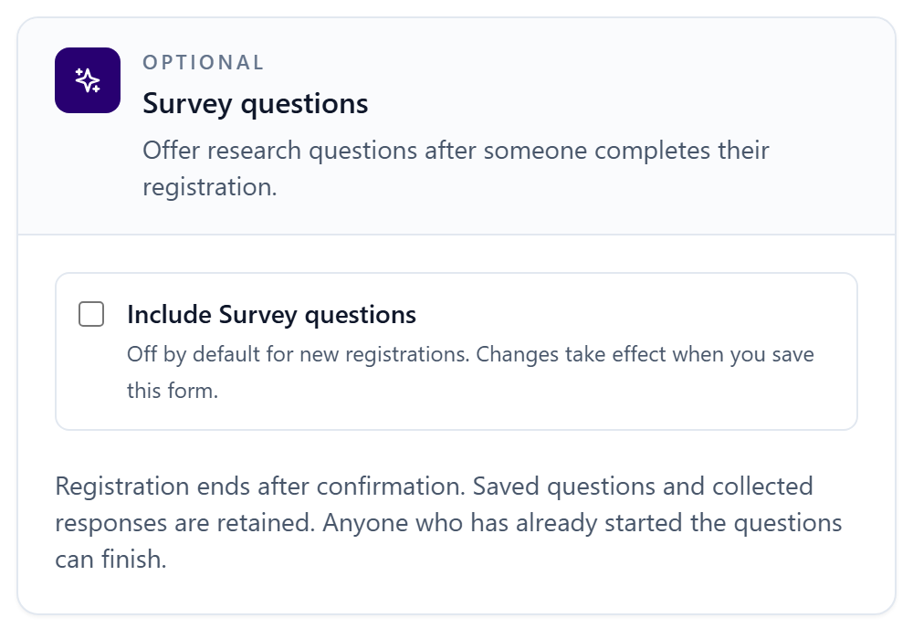

Optional Survey questions let registrants provide additional research information after booking.

{/* Available with */}
{/* Let Q-bit do it */}

Open **Form > Survey questions** and enable **Include Survey questions**. For example, offer a short follow-up about a participant's interests after they have registered, and review how the answers will be associated before publishing.

## Choose how responses are linked

Choose how responses are linked. **Group results by session** retains the session without linking the response to the person's registration. **Link to each registrant** connects the response to the registration, so explain that use in the privacy notice.

## Build and publish the questions

Choose **Open Survey builder**, create the questions, and publish the Survey. Save the Registration form as well. Survey language review and publication are separate from Registration content publication.

After booking, a confirmation page can offer **Continue to additional questions**. Registration contact and booking details are stored separately from Survey responses. Turning questions off preserves saved questions and collected responses; someone who already started can finish.

Before opening registration, check the Survey's published version. If there are unpublished changes, publish them or explicitly choose the current published version. If the Survey cannot be checked, restore access and try again.

## Related tasks

- [Translate and publish Registration content](./translate-and-publish-content)
- [Open and share a registration](./open-and-share-registration)

