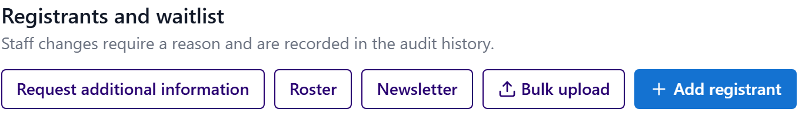
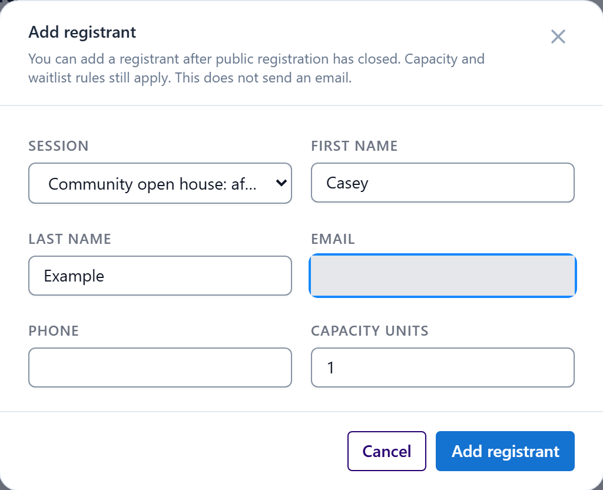

Add or import registrants to record bookings that staff receive outside the public form.

{/* Available with */}
{/* Let Q-bit do it */}

Staff can add a registrant from **Registrants**, including after public registration closes. Use **Add registrant** for one person or **Bulk upload** for a prepared roster, and review the result before contacting people.

1. Choose **Add registrant** and select the session.
2. Enter first name, last name, email, optional phone, and capacity units. Choose **Add registrant**.

   
3. Review the resulting booking. Capacity and waitlist rules still apply. Adding the person does not send an email.

   

To add several people, choose **Bulk upload** and download the template. Include session, first name, last name, and email. A session can be identified by its ID, internal name, or public title. Optional columns include phone, locale, capacity units, and operational data. Upload up to 500 registrants and review validation and the result. Import does not send emails.

If a row cannot be added, check the session and supplied details and correct the file before retrying. Communicate with people separately after reviewing the audience and message.

## Related tasks

- [Manage registrants and waitlists](./manage-registrants-and-waitlists)
- [Send a one-time registration message](./send-a-one-time-message)
