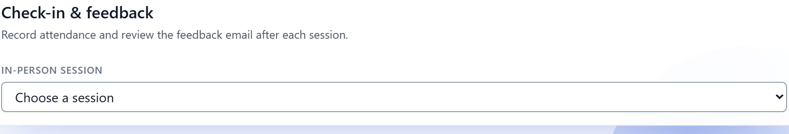

Check-in records which confirmed registrants attended a session.

{/* Available with */}
{/* Let Q-bit do it */}

Staff with check-in access can open **Check-in & feedback**, select the session, and choose **Check-in**. For example, mark a confirmed participant present on arrival, then correct the entry if the wrong person was selected.

## Record attendance

Search by name or email, or use **All**, **Not checked in**, and **Present** to filter the roster. Choose **Present** beside a confirmed registrant. The summary updates to show present people out of confirmed registrants. To correct an entry, choose **Undo**.

If a person is not confirmed, review their booking before check-in. Check-in records attendance and does not itself send an email. Use the staff check-in link for the selected session when another authorised staff member needs the focused roster. They must sign in with their own access.

If the list or a change cannot be loaded, refresh and check the current attendance before retrying. Keep the roster private when sharing a device.

## Related tasks

- [Manage registrants and waitlists](./manage-registrants-and-waitlists)
- [Add or import registrants](./add-or-import-registrants)
- [Access assigned registrations](../participant-help/registration/access-assigned-registrations)
