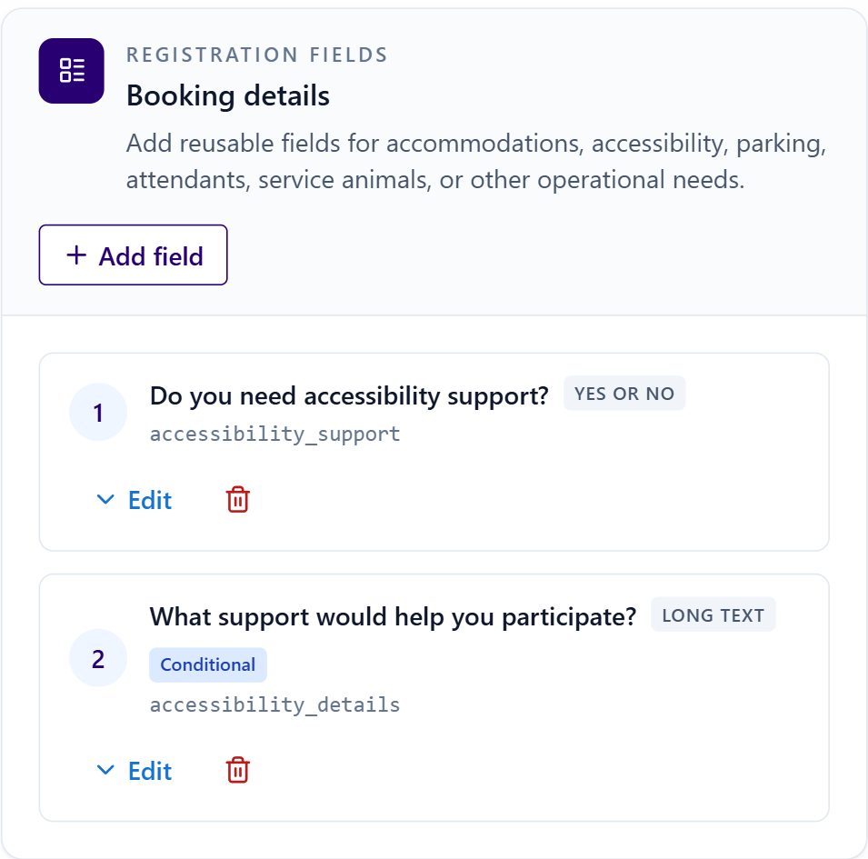
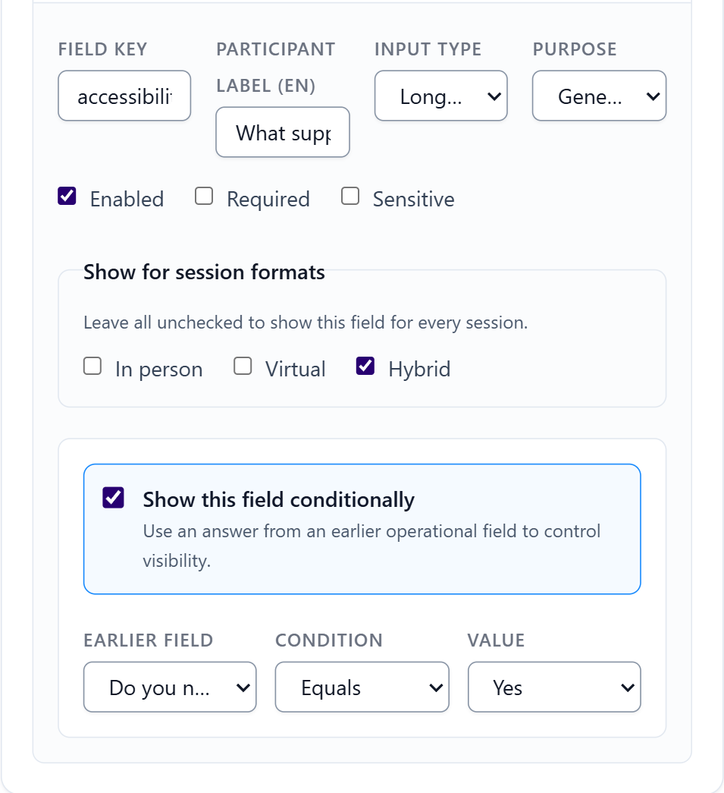

Registration fields collect the contact and booking details needed for a session.

{/* Available with */}
{/* Let Q-bit do it */}

1. Open the Registration and select **Form**.
2. Select **Registration fields**.
3. Review the core first name, last name, and email fields. You can change their labels. Enable **Phone** if needed and choose whether it is required.
4. Collect only the details needed for the booking, and review how sensitive fields will be handled.
5. Select **Save form** after making changes. Check for the **Saved** status.

## Add booking details

Under **Booking details**, choose **Add field**. Enter a field key and participant label, then choose its type and purpose. Set **Enabled**, **Required**, and **Sensitive** as needed. New fields start as enabled, optional, non-sensitive short text with a general purpose. Types include short and long text, email, phone, number, single or multiple choice, yes/no, and consent. For choice fields, add option codes and labels; codes are used in exports and display logic.

Under **Show for session formats**, choose in-person, virtual, or hybrid. Leave all unchecked to show the field for every format. A later field can use **Show this field conditionally** with an earlier field and a comparison. For example, show an accessibility details field when an earlier yes/no question is answered **Yes**. Test both answers and session formats. Negative and unanswered conditions can match a blank answer.

Only visible operational fields are submitted.

## Newsletter sign-up

Under **Newsletter sign-up**, optionally add a label and consent wording version. This choice is optional and does not connect a newsletter service. Choose **Save form** after reviewing the preview.

## Related tasks

- [Set privacy notices and consent](./set-privacy-and-consent)
- [Add optional Survey questions](./add-optional-survey-questions)
