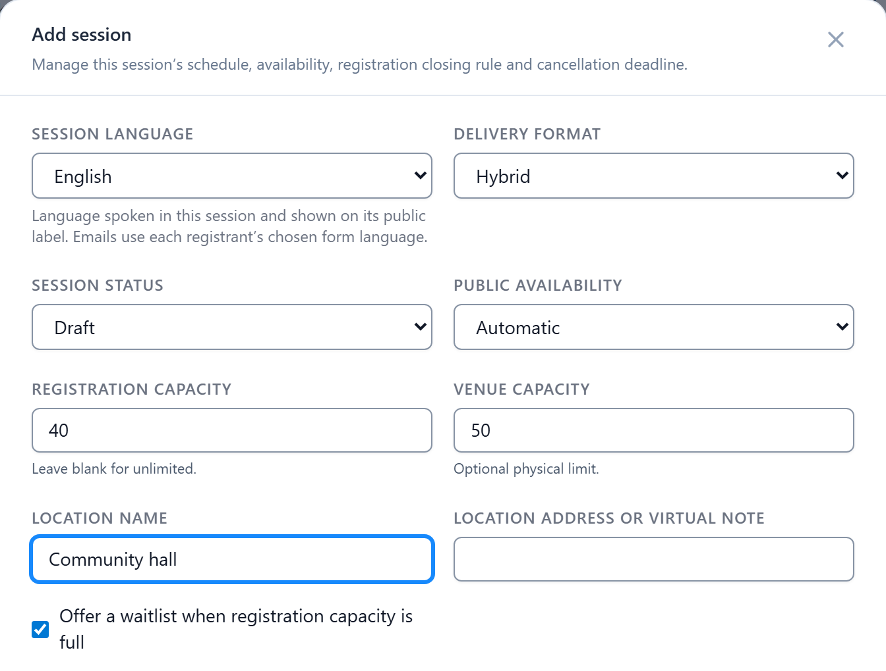

Waitlist and offer settings control how people can claim places that become available after a session fills.

{/* Available with */}
{/* Let Q-bit do it */}

Open **Settings > Booking defaults** to choose whether to **Offer a waiting list when full** and set the usual **Time to accept an offered place (minutes)**. Review each session under **Sessions** before opening registration. For example, use a shorter claim time near the start only when the offer cutoff and email wording are ready.

## Set a session policy

In a session, select **Offer a waitlist when registration capacity is full**. Under **Waitlist offers**, set an optional deadline for ending offers before the start. Leave it blank to use the registration setting. This deadline applies to new offers and claims.

To shorten offers near the session, enter both **Shorter offers within (hours of start)** and **Time to claim a shorter offer (hours)**, or leave both blank for the usual claim time. The shorter-offer window must begin before offers end. Existing offers keep their original deadline.

## Review before saving

Review the offer email wording before saving: saving a policy can immediately offer available places to the next people waiting. Offers can continue after new registrations close.

A recipient uses the personal offer link to accept or decline before its deadline. Staff can review the queue in **Registrants**.

## Related tasks

- [Manage registrants and waitlists](./manage-registrants-and-waitlists)
- [Cancel a booking or answer a waitlist offer](./cancel-or-answer-an-offer)
