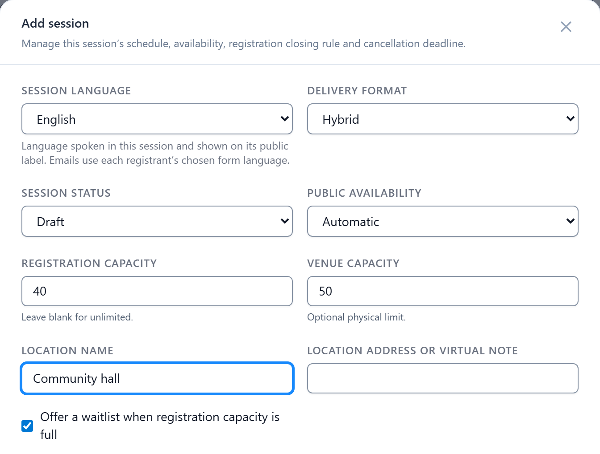
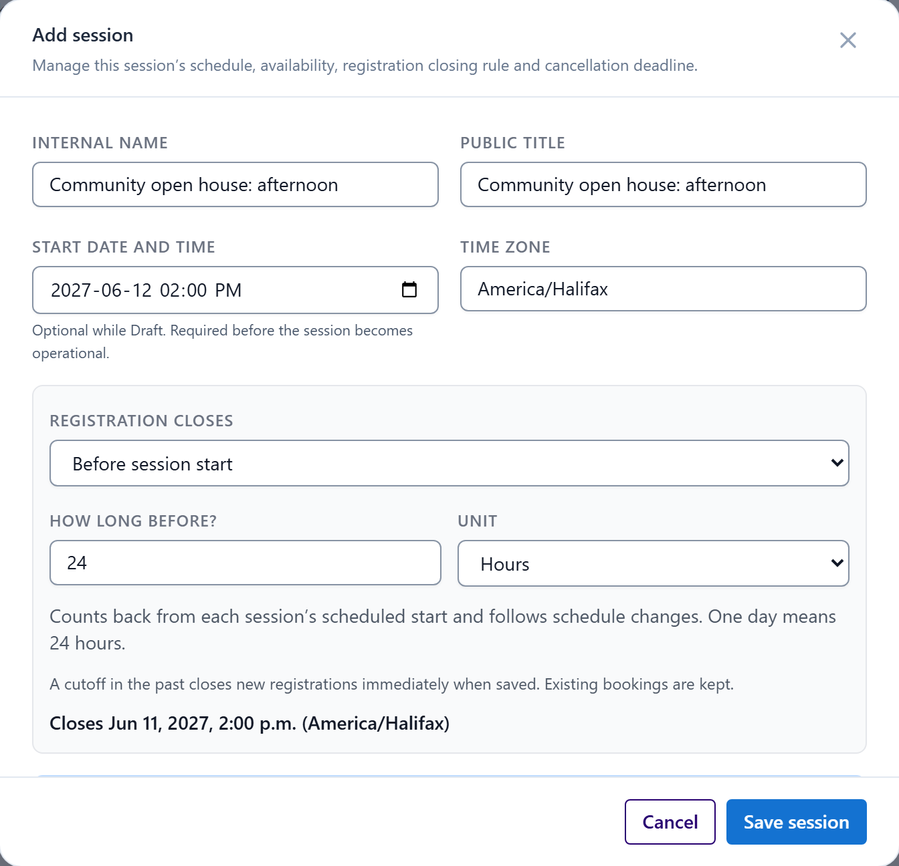

Capacity and closing settings control when people can book a session and how many places are available.

{/* Available with */}
{/* Let Q-bit do it */}

Open **Sessions** and select a listing. **Registration capacity** limits registration places; **Venue capacity** is a separate physical limit. A blank registration capacity is unlimited for a standalone session. A connected Session can use a campaign or room limit. For example, check both limits and guest-counting settings when organising an in-person session.

## Set booking defaults

In **Settings > Booking defaults**, use **Count places for** to choose **One person per registration** or **The registrant and their guests**. Set **Maximum guests per registration** when using the latter. For example, counting guests means a booking can use more than one available place.

To check one session's booking settings:

1. Select **Sessions**.
2. Select the session's name.
3. Check **Registration capacity** and **Venue capacity**. For the fictional afternoon session, 40 registration places and a venue limit of 50 are separate limits.
4. Choose **Public availability**: **Automatic** follows Registration and session status, dates, and capacity; **Waitlist only** directs eligible new bookings to the waitlist; **Closed** prevents public selection.
5. Choose **Save session** after making changes. Check the session list for its status and availability.

## Set a closing rule

Under **Registration closes**, choose no custom time, a countback in hours or days, or a fixed date and time. Countbacks follow schedule changes. A fixed time must be before the start and after registration opens. A past cutoff closes new registration when saved, while existing bookings remain. With no custom cutoff, a standalone session has no automatic time cutoff and a connected session closes at its start.

Online cancellation has a separate deadline. Select multiple sessions to apply a closing rule or availability action, then review the result for each. Use the public link to check current availability; the form preview does not calculate live capacity.

## Related tasks

- [Create and manage session listings](./create-and-manage-sessions)
- [Configure waitlists and offers](./configure-waitlists-and-offers)
