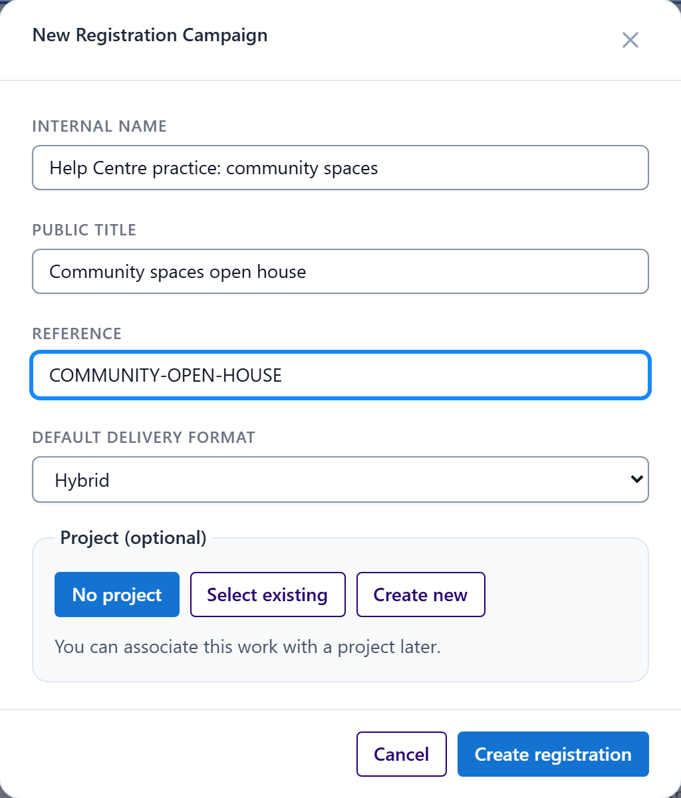

A Registration collects bookings for one or more sessions using a form and related settings.

{/* Available with */}
{/* Let Q-bit do it */}

Organisers can create a new setup or find an existing one to continue their work. For example, create a Registration for a fictional community spaces open house with an afternoon session.

1. Open **Registrations**.
2. Choose **New registration**.
3. Enter an **Internal name**, such as `Help Centre practice: community spaces`.
4. Enter the **Public title** participants will see, such as `Community spaces open house`.
5. Add an optional **Reference**.
6. Select the **Default delivery format**.
7. Choose a project, or **No project**. A registration started from a Session Group uses its project association.
8. Choose **Create registration**. The new Registration workspace opens.

If **Create registration** is unavailable, check the internal name, public title, and project selection. If creation reports an error, read the message before retrying.

## Prepare the first booking

1. [Add an afternoon session](./create-and-manage-sessions) with its date, time, and capacity.
2. [Write the form](./write-and-style-the-form), check the registration fields, and [review privacy and consent](./set-privacy-and-consent).
3. Use **Preview page** or the form's **Phone** preview to review the page. These previews do not submit a booking.
4. When a publication notice applies, [publish the saved content](./translate-and-publish-content).
5. [Open the Registration and its link](./open-and-share-registration) when the session and form are ready.
6. After a participant submits the public form, check the booking under [Registrants](./manage-registrants-and-waitlists).

Saving content, publishing it when required, opening Registration, and making an individual session available are separate steps. Creating a draft does not reserve a place.

Return to the registration by selecting its name in the list. Choose **Current** or **Archived** under **Show registrations**. Use **Clone** to reuse a setup, then review the new draft. Registrants and live delivery history are not copied. Review the effects on linked records before archiving.

If a Session Group connection fails during creation, open **Settings** and check the connection before continuing. Next, [navigate the workspace](./navigate-registration-workspace).

## Related tasks

- [Create and manage session listings](./create-and-manage-sessions)
