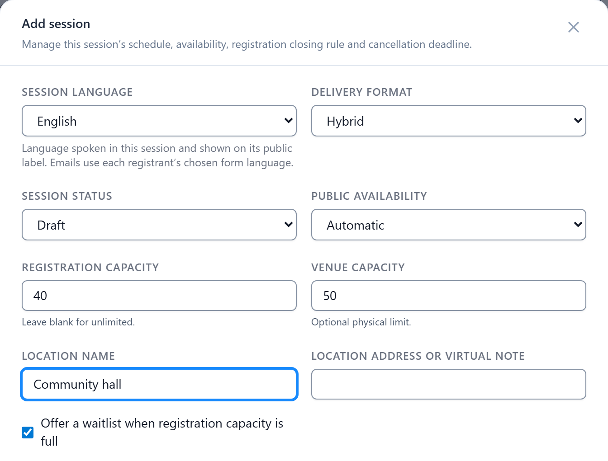

Session listings give registrants the dates, formats, and booking options they can choose.

{/* Available with */}
{/* Let Q-bit do it */}

For example, add an afternoon session for the fictional community spaces open house. A session needs a start time and an operational status before people can book it.

1. Open the Registration and select **Sessions**.
2. Choose **Add session**.
3. Enter an **Internal name** and **Public title**, such as `Community open house: afternoon`.
4. Enter the **Start date and time** and **Time zone**. A start time can be left blank while the listing is **Draft**.
5. Check **Duration (minutes)** and **Session language**.
6. Choose the **Delivery format** and enter the location or virtual note.
7. Set **Registration capacity**, **Venue capacity**, and any waitlist, closing, and cancellation rules. For example, use 40 registration places and a venue limit of 50 for the fictional event.
8. When the session is ready to be available, choose **Scheduled** under **Session status** and **Automatic** under **Public availability**.
9. Choose **Save session**. Check that the session appears in the list with the intended status and availability.

For an existing open Registration, changing a session's status or availability can affect public booking. A scheduled session still needs the overall Registration to be open, and its dates, capacity, and availability must permit booking.

A new listing starts as Draft with automatic availability and a 90-minute duration. Review its date, time zone, language, and format before saving. Session language describes the language spoken at the session. It is separate from form language. The optional time zone label is shown to participants; scheduling uses the **Time zone** value.

When connecting an available virtual Session, choose it in the editor. Its title and schedule come from Sessions, where later schedule changes are managed. Review the listing after connecting it.

For many listings, choose **Bulk upload**, use the CSV template, and review validation before importing up to 500 sessions. To update existing listings together, select them and choose a bulk action. Check the result and refresh before retrying failed rows.

Next: [Control capacity and closing](./control-capacity-and-closing).

## Related tasks

- [Configure waitlists and offers](./configure-waitlists-and-offers)
