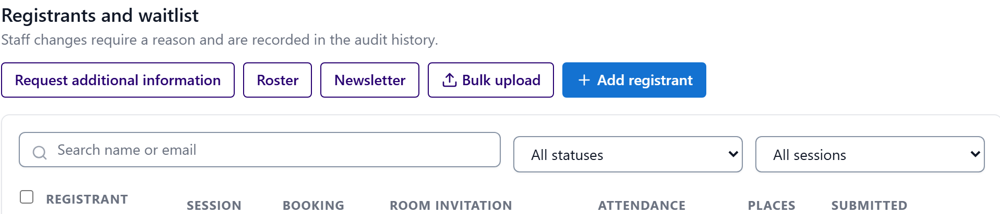

The registrant list lets staff review bookings and manage eligible waitlist or status changes.

{/* Available with */}
{/* Let Q-bit do it */}

## Find a booking

1. Open the Registration and choose **Registrants**.
2. Search by name or email. Use the details the participant entered or the details staff supplied when adding the booking.
3. Check the **Session** and **Booking** columns for the intended session and status. The table also shows room invitation, attendance, places, and submission time.
4. Select a name to review information requests for that person.

This example shows a booking added by staff.

If the booking is missing, clear the search and select **All statuses** and **All sessions**. Refresh the list or use **Retry** if the list failed to load. A non-submitting preview does not create a booking. Shared test-link submissions are separate and appear under **View test results**, not in the live roster.

## Change a booking

Use the available action for the current status: **Confirm**, **Waitlist**, **Offer seat**, **Cancel**, or **Restore to waitlist**. Review the person and session, enter a **Reason for this change**, and confirm. The reason is recorded in the audit history.

Restoring an expired entry returns it to its original waitlist position without another waitlist-confirmation email. If offers are open and a place is available, an offer may be sent automatically. Review the offer policy and message first.

If a change fails, refresh the list, check the current booking and available places, and try again. Use **Request additional information** when you need a separate personal form rather than changing a booking.

## Related tasks

- [Add or import registrants](./add-or-import-registrants)
- [Request additional information](./request-additional-information)
