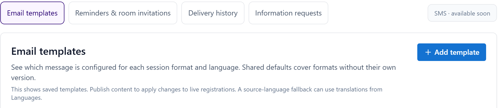

Registration email templates provide reusable wording for messages sent during the booking process.

{/* Available with */}
{/* Let Q-bit do it */}

Open **Messages > Email templates** to review coverage by message type, language, and session format. A shared template can cover more than one format. For example, check both English and French confirmation wording before opening a bilingual registration. Review any missing combinations before sending.

## Edit and test a template

Choose an existing template to edit it, or add one for a missing scope. Set the message type, language, session format, sender name, reply-to address, subject, and body. Use the editor and preview to check formatting and personalisation. Send a test to approved addresses and review the received message.

Save the template when ready. Where published Registration content is in use, a saved template can remain a draft until content is published. Check the publication notice before relying on live wording. Publishing does not send an email; already queued messages keep their original wording.

## Draft wording with Q-bit

You can ask Q-bit to prepare email wording for an existing Registration, including an open campaign. In the Registration, open **Q-bit** and specify the message type, language, and session format. For example, ask for a French confirmation email for an in-person session.

1. Choose **Review email draft** in Q-bit's response. Check the type, language, format, subject, body, sender details, and personalisation in the email editor. Edit the draft as needed.
2. Choose **Save inactive draft**. This puts the version in Email Templates history; it does not replace the active template or send an email.
3. Choose **Open Email Templates history** to review the saved version. When ready, use **Restore as current template** and confirm. Restoring creates a new active version and moves the current template for the same type, language, and format to history.
4. If the Registration uses published content, publish the content or the template as appropriate to apply the restored wording to new live emails. Test the saved template and use the Registration's message or reminder controls to send it.

Q-bit email drafting is separate from changing the Registration form, which requires an unused draft campaign. See [Create a setup with Q-bit](../get-started/create-a-setup-with-qbit).

## Review history

Use template history to inspect or restore a previous version. Deactivate a template only after reviewing the coverage it provides. If a test fails, check the addresses and sender settings, then retry.

## Related tasks

- [Schedule reminders and room invitations](./schedule-registration-reminders)
- [Send a one-time registration message](./send-a-one-time-message)
