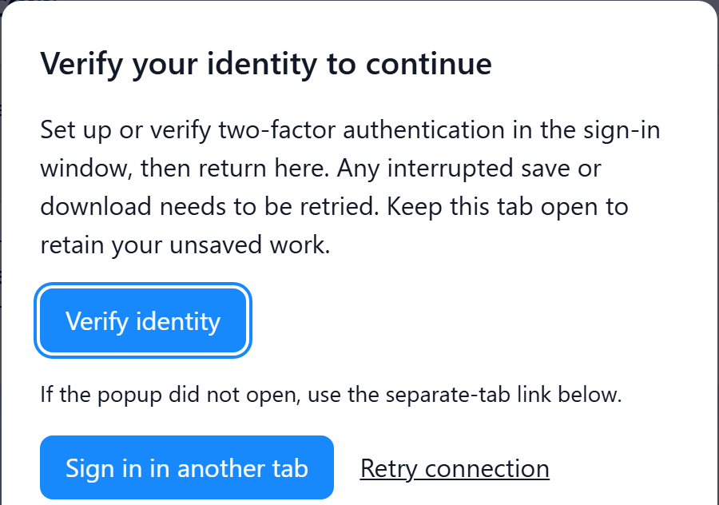

Roster export access lets owners and administrators restrict downloads to named people and approved fields.

{/* Available with */}
{/* Let Q-bit do it */}

Open the registration and choose **Manage export access**. For example, assign a named person to one session when they need its roster, then review the scope and expiry before creating access.

## Review the standard export

Open **Export settings** to inspect the organisation's standard fields. Record the data owner's approval reference when approval is needed. This approval applies to the standard export across the organisation. In the Registration's **Export access** page, add or edit **Download terms** for that Registration and save them.

## Add an exporter

1. Choose **Add exporter**, enter the named recipient's email, and select all sessions or one session.
2. Review included fields. Choose an immediate or scheduled start and an expiry date.
3. Review the details and choose **Create invitation**. Copy the invitation link and share it privately with the named person. Creating it does not send an email. An existing external account may receive access directly.

The recipient can download only assigned sessions and approved fields and must complete the required identity verification. Review **Current**, **History**, and **Activity** to inspect access and download events. Cancel a pending invitation or remove access when it is no longer needed. Previously downloaded files cannot be recalled.

If an action requires verification, complete it and return to the page. If access changed, refresh and review the current state.

## Related tasks

- [Access assigned registrations](../participant-help/registration/access-assigned-registrations)

