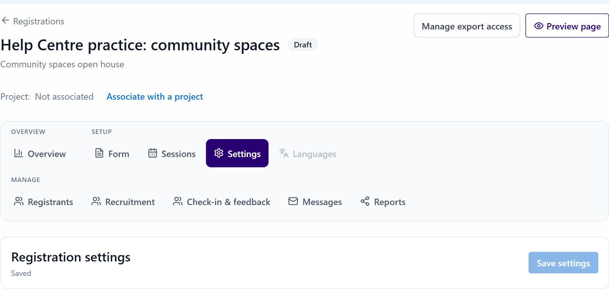

The Registration workspace brings form setup, session management, and booking tools together.

{/* Available with */}
{/* Let Q-bit do it */}

1. Open **Registrations**.
2. Select a registration by name. Its workspace opens.
3. Use the setup areas to prepare the form and sessions, then use the management areas to work with bookings and communications.

## Find a section

**Overview** shows its summary. **Setup** contains **Form**, **Sessions**, **Settings**, and **Languages**. **Manage** contains **Recruitment**, **Registrants**, **Check-in & feedback**, **Messages**, and **Reports**.

Choose **Preview page** to inspect the form without submitting a booking. The preview is separate from the public registration link. It can show draft sessions and does not establish live capacity. Find public and test links under **Settings > Links & connections**. A submitted shared test link is also separate from the live roster and does not reserve a live place.

The publication notice shows whether saved content matches the published version. If its status cannot be verified, check again before relying on the live form. Save your edits before leaving and read any unsaved-changes warning.

Next: [Write and style the form](./write-and-style-the-form).

## Related tasks

- [Open and share a registration](./open-and-share-registration)
