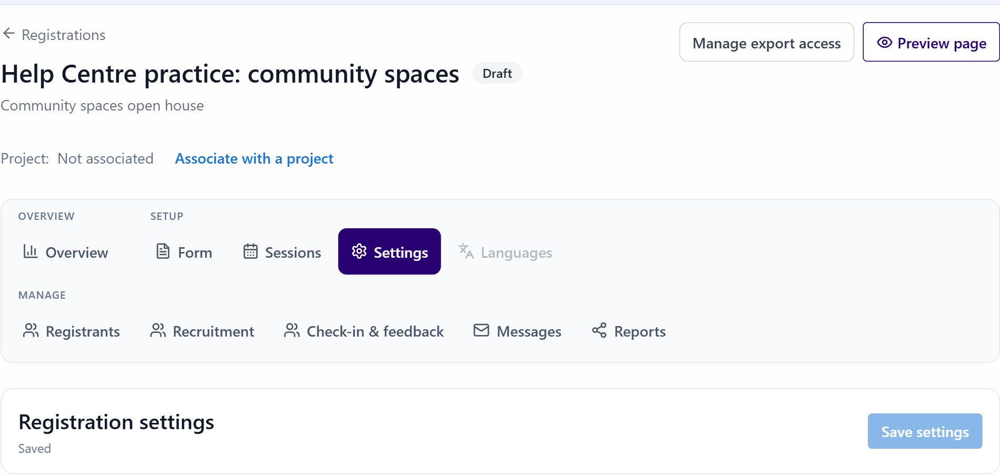

Open and share a registration when the form, sessions, and any linked questions are ready for bookings.

{/* Available with */}
{/* Let Q-bit do it */}

For the fictional community spaces open house, review the form and the afternoon session before opening the public link. A scheduled session must also be available under its own status, dates, and capacity.

## Prepare and open

1. Save and preview the form. Check the session date, **Scheduled** status, capacity, and **Public availability**.
2. Review the Registration publication notice when it appears. [Publish saved content](./translate-and-publish-content) when required.
3. If optional Survey questions are enabled, publish the linked Survey first. When the Survey has unpublished changes, publish them or confirm that you want to use its current published version.
4. Open **Settings**, then **General**.
5. Change **Registration status** to **Open for registration**.
6. Choose **Save settings**. Check the Registration status after saving.
7. Open **Links & connections** in Settings.
8. Under **Registration links**, check that the intended URL is not closed. If **Close this URL** is selected, clear it and choose **Save** for that link.
9. Choose **Open** to check the public page, or **Copy** to share the link with the approved audience.

If no direct URL is listed, choose **Add URL**, enter an internal label and link address, and choose **Add URL** in the dialog. You can change a link's label or availability later. A shared link's address may be locked after use. Set the page shown when registration is not open, then save settings.

If the public page is closed or the session cannot be selected, check the Registration status, the individual URL, and the session's status, dates, availability, and capacity. Previewing or publishing content does not open Registration or reserve a place.

## Test before inviting people

Under **Settings > Links & connections**, find **Shared test links** and choose **Create test link**. Choose **Open test link** to run the registration and optional Survey, then use **View test results** to inspect test submissions. Test submissions are separate from the live roster and do not reserve live places. The test can send real emails marked TEST to the address entered, so use an approved test address. Save changes and reopen the link to test the latest saved setup.

For an actual booking, a participant uses the public link and submits the form. Check the confirmation and then the live [Registrants](./manage-registrants-and-waitlists) list. Use an approved synthetic Registration and address for a controlled rehearsal. An actual submission can reserve a place and send a confirmation email.

To stop new bookings, change registration status to **Closed to new registrations** and save. Existing cancellation and offer deadlines are separate.

## Related tasks

- [Translate and publish Registration content](./translate-and-publish-content)
- [Register for a session](./register-for-a-session)
