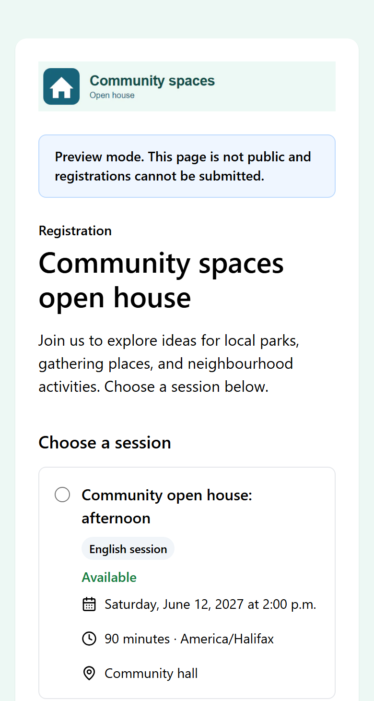

Register for a session to request a place or join its waitlist when offered.

{/* Available with */}
{/* Let Q-bit do it */}

Open the registration link provided by the organiser on your phone or computer. Choose your language if a language selector is available. Check the session details before submitting, especially if the organiser offers several dates or formats.

1. Choose a session, such as `Community open house: afternoon`. Review its date, time zone, location or online requirements, and availability. A closed session cannot be selected. A full session may offer a waitlist.
2. Read the privacy notice. Select the agreement if it is required.
3. Enter your first name, last name, and email address, and complete any other requested details. Field labels can differ by form.
4. Choose **Register** for an available session, or **Join waitlist** when a waitlist is offered.
5. If a message identifies missing or invalid information, correct it and submit again.
6. Read the confirmation page. **You are registered** indicates a confirmed place; **You are on the waitlist** indicates a waitlist entry.

The confirmation may include a link to manage your registration or continue to additional questions. Follow any instructions from the organiser. A page labelled as a preview does not submit a booking. A shared test link can show a test confirmation, but it is separate from a live booking and does not reserve a place.

If the page says the form changed, refresh it and review your session and privacy choices before submitting. If registration is closed or no session is available, contact the organiser for help.

## Related tasks

- [Cancel a booking or answer a waitlist offer](./cancel-or-answer-an-offer)
- [Answer an information request](../participant-help/registration/answer-an-information-request)
