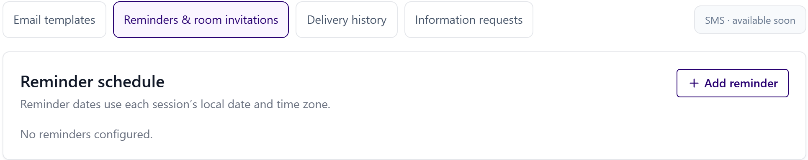

Reminder settings schedule registration messages and control when personal room invitations are sent.

{/* Available with */}
{/* Let Q-bit do it */}

Open **Messages > Reminders & room invitations** to review the reminder schedule. Registration reminders apply to standalone events. For a connected Session, use the link to manage room invitations and reminders in that Session. Check the session's time zone and late-registration policy before enabling a rule.

## Add or edit a reminder

Choose **Add reminder**. Select all sessions or one session, enter the days before and local send time, and choose what happens when a person registers after the scheduled reminder: send immediately or skip. Save the rule. Reminder dates use the session's local date and time zone. Edit an existing rule to change or pause it.

## Set room invitation timing

Under **Settings > Booking defaults**, choose when personal room invitations are sent: when staff choose, after a confirmed booking connects to the room, or at a specified number of minutes before or after the start. Save settings.

Review the appropriate email templates and session times before enabling delivery. Editing a reminder does not change messages already sent. Check **Delivery history** for queued and delivery outcomes.

## Related tasks

- [Manage registration email templates](./manage-registration-email-templates)
- [Send a one-time registration message](./send-a-one-time-message)
