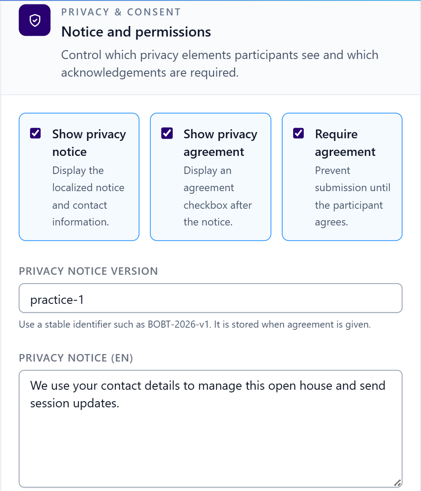
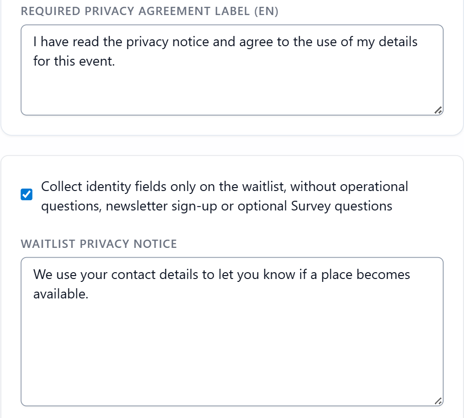

Privacy and consent settings determine the notice and agreement registrants see before submitting.

{/* Available with */}
{/* Let Q-bit do it */}

Open **Form > Privacy & consent** to prepare the wording and decide whether an agreement is required. For example, provide a waitlist-specific notice when the information collected at that stage differs from a confirmed booking.

1. Select **Show privacy notice** if the notice should appear.
2. Select **Show privacy agreement** if the form should display an agreement checkbox.
3. Select **Require agreement** if a participant must agree before submitting. The agreement must be shown before it can be required.
4. Enter the **Privacy notice version**, notice, contact information, and agreement label. Add a shared notice link or a language-specific **Privacy statement URL**.
5. Review the wording in each offered language.
6. Choose **Save form**. Check for the **Saved** status, and publish content when the publication notice requires it.

A required agreement must be selected before submission. The language-specific URL takes precedence over the shared link. A separate **Waitlist privacy notice** replaces the ordinary notice for a waitlisted choice when supplied.

Enable **Collect identity fields only on the waitlist** when booking questions, newsletter sign-up, and optional Survey questions are not needed at that stage. Core identity and the configured privacy controls remain. Review your notice with the person responsible for privacy wording before opening registration.

If the form changes during submission, the registrant is asked to refresh and review their privacy choices again.

## Related tasks

- [Translate and publish Registration content](./translate-and-publish-content)
- [Configure waitlists and offers](./configure-waitlists-and-offers)
