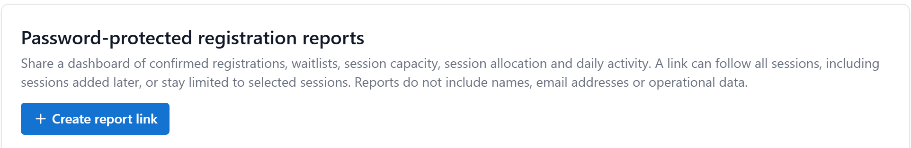

Registration reports summarise booking activity and can be shared without providing a named roster.

{/* Available with */}
{/* Let Q-bit do it */}

Open a registration and choose **Reports**. Use the aggregate dashboard to review activity, or the separately authorised roster export when a recipient needs individual details.

If supplementary Survey questions are enabled, the page shows started and completed responses by session and links to the Survey reports. The registration dashboard covers confirmed registrations, waitlists, capacity, session allocation, and daily activity. It does not include names, email addresses, or operational data.

## Create a protected link

1. Choose **Create report link**, enter a report title, and set a password of at least eight characters.
2. Choose **All sessions, including new sessions** to include sessions added later, or **Selected sessions** and select at least one.
3. Choose **Create protected link**. Copy the link and share the password separately with the intended reader.

Use **Edit** to change the title or session scope of an existing link. Use **Revoke** to stop access. The reader opens the link and enters its password to view the dashboard. If the link or report cannot load, check its status and scope before retrying. Use the separately authorised roster export when names or operational details are needed.

## Related tasks

- [Manage roster export access](./manage-roster-export-access)
