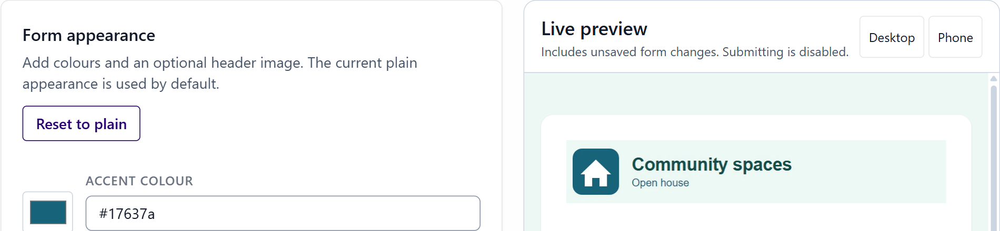
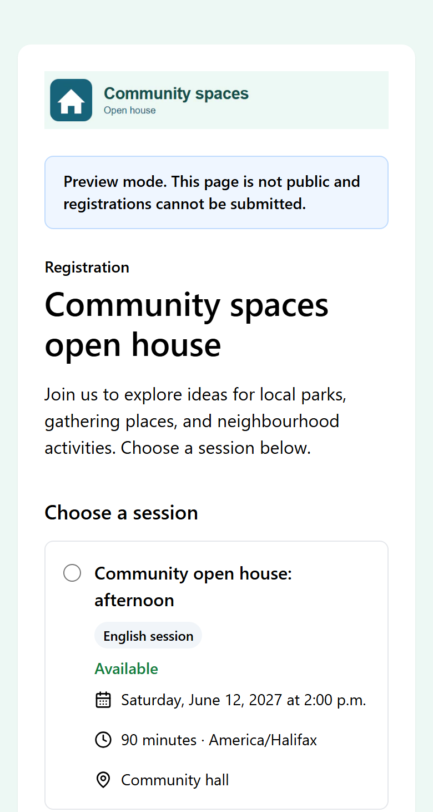

The registration form presents session choices and information people need before booking.

{/* Available with */}
{/* Let Q-bit do it */}

Organisers can open a registration and select **Form** to prepare the page. For example, add an introduction explaining the event and preview the session picker on a phone before sharing the link.

1. Open the Registration and select **Form**.
2. Select **Public page**.
3. Enter the **Public title (EN)** and **Introduction (EN)**. For the fictional open house, explain what the event is and who should register.
4. If needed, add confirmation and waitlist messages and FAQs. An FAQ appears when both its question and answer are present.
5. Under **Session picker**, choose **Session cards** or **Dropdown menu**. Add session selection instructions and an introduction for a full session if needed.
6. Select **Appearance**. Choose an accent colour and a plain, solid, or gradient background. Upload an optional header image. Provide a description for a meaningful image, or leave it blank if decorative. English and French can use separate images; otherwise the default is used.
7. In **Live preview**, choose **Phone** to inspect the narrow layout. Choose **Desktop** to inspect the desktop layout.
8. Choose **Save form**. Check that the form status shows **Saved**.

The preview cannot submit a booking. Where content is published, saving is separate from updating the live form. See [Translate and publish content](./translate-and-publish-content). If an image fails to upload, retry it before saving.

## Related tasks

- [Configure registration fields](./configure-registration-fields)
- [Set privacy notices and consent](./set-privacy-and-consent)
