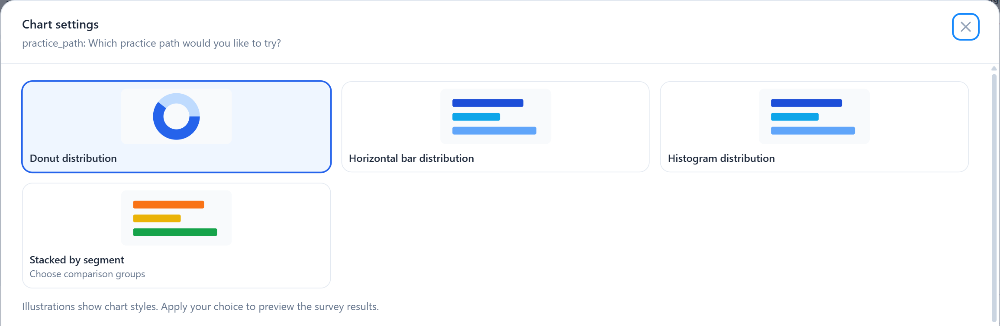

Report charts show survey results in a visual or table that can be reviewed and downloaded individually.

{/* Available with */}
{/* Let Q-bit do it */}

Report authors can add charts in a standard report workspace and adjust each block to suit its question and audience. For example, a horizontal bar chart can make choice results easier to compare; check its base and display settings before exporting it.

1. Add a chart for a reportable question. Choose from the chart types offered for that question. Availability depends on the question and supported results.
2. Open the chart settings to edit its title, section, width, question ID visibility, ordering, and decimal places. Where offered, display percentages, counts, or both. The width choices are **One third**, **Half**, **Two thirds**, and **Full**. Decimal places range from 0 to 6. A new chart starts at full width, question order, highest-first direction, and percentage display. Question identifiers follow the report default, which initially hides them.
3. For supported choice or grid charts, group options when a combined result is useful. An option can belong to only one group. Set a chart-specific filter or comparison presentation if needed.
4. Choose **Use chart settings**, then **Apply changes** and check the chart, table, and displayed base. Choose **Save** to retain the definition.
5. Use the chart's download control to export PNG, SVG, or PDF. The export dialog offers options such as title, labels, legend, and sample size when applicable. Check the downloaded file before sharing it.

The available families include distributions, bars, histograms, KPIs, trends, segment charts, grids, rank charts, word clouds, and Brand Affinity views. [Chart types](./standard-report-chart-types) explains the main families. Percentages depend on the stated base, and multi-select results need not add to 100%. A chart download is an individual result; it does not download the whole report.
