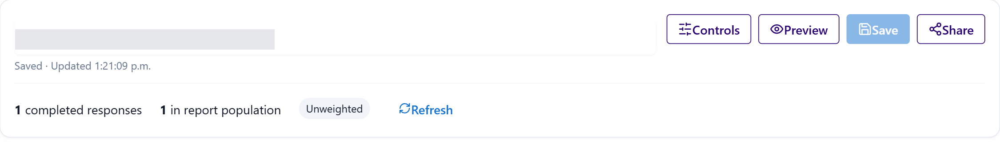

A standard report is a saved definition of survey questions, charts, population, and presentation used to calculate results.

{/* Available with */}
{/* Let Q-bit do it */}

Analysts can create one from a survey's **Reports** tab. A report is separate from a response-data export and from a shared snapshot. Before interpreting results, check which responses are included and the base for each chart.

## Create a first report

For example, use the fictional community spaces survey from [Start a survey](../surveys/start-a-survey), after a completed test response has been recorded. Use a synthetic survey and follow your organisation's process for keeping test results separate from customer data.

1. Open the survey.
2. Select **Reports**.
3. Choose **Create**.
4. Enter a **Report name**, such as `Community spaces results`. A blank name becomes “Survey report.”
5. Keep **All current reporting questions** selected, or choose **Choose questions** and select the question you need.
6. Select **Create and open**. The report workspace opens and prepares its results.
7. Check the number of **completed responses** and the number **in report population**. Review the question chart and its base.
8. If results are still being prepared, wait or use **Refresh**. Check the displayed error if calculation fails.

If the only included completed response answered Library, and it answered this question, the example result is Library: 1 of 1 responses (100%). A single test response checks that the path works; it does not describe a wider population. If the expected response is missing, check its status in [Responses](./review-survey-responses), the report population, and the chart base. Preview responses and fieldwork responses can be treated differently.

## Change the report

1. Add, repeat, reorder, or remove chart blocks, and use sections to organise the results. A block can inherit its title from the question or use a custom title.
2. Set the report population and, when needed, a comparison or weighting scheme. See [filter, compare, and weight results](./filter-compare-and-weight).
3. If **Apply changes** is shown, select it to calculate the working definition. While calculation runs, charts show the last applied results.
4. Check the updated result and its bases.
5. Select **Save** when there are unsaved changes. The status changes to **Saved**.
6. Select **Preview** to review the report without editing controls. Select **Edit report** to return to editing.

The report list also offers actions to duplicate, set a default, or delete a report. Check the selected report before deletion. If results are still calculating, the last applied results remain visible. If a save conflict or error occurs, choose **Keep working copy** to download the working JSON, then choose **Reload saved report** and reconcile them before saving again.

Saving the definition does not update a shared snapshot. For recipients, follow [publish and share a report](./share-standard-report).
