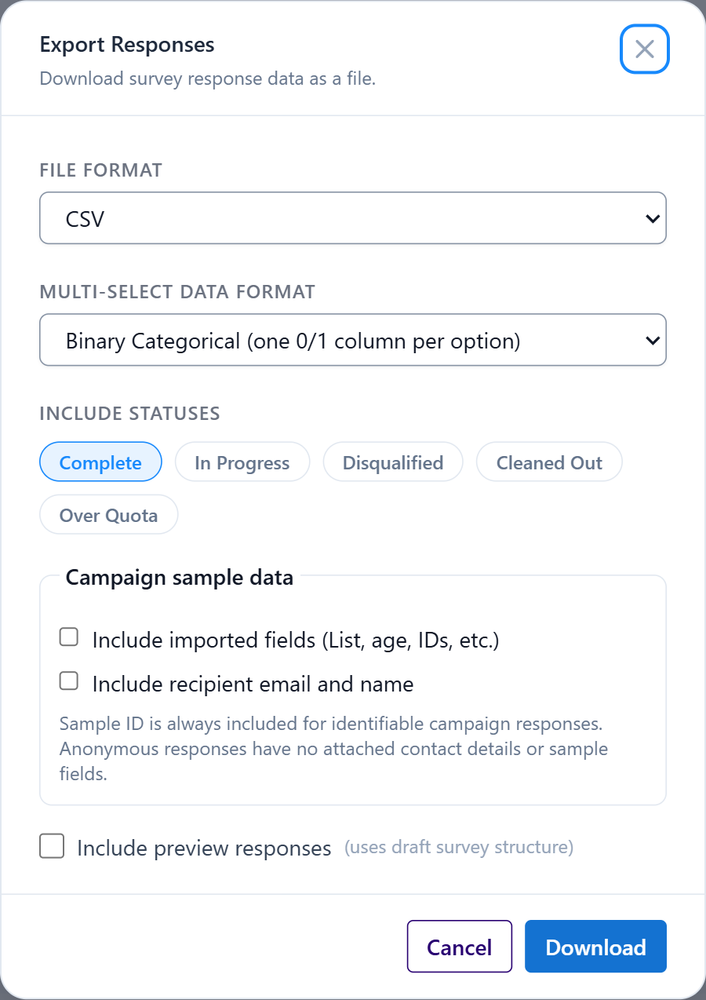

Export responses to obtain data for analysis outside the survey workspace.

{/* Available with */}
{/* Let Q-bit do it */}

Analysts with export access can download data from a survey's **Responses** tab. Choose the format and statuses for the intended analysis, and review the privacy options before downloading. Response-list search and date filters are not passed to the export; set the scope in the export dialog. Use a chart download for one report visual or a shared report for a prepared stakeholder view.

1. Select **Export** and choose **File format**. CSV is the initial format for an ordinary survey; SPSS (.sav) is also available. If the survey contains a Record Collection, use **Complete Record Collection package (.zip)**.
2. Choose **Multi-select data format**. **Binary Categorical** creates a 0/1 column for each option. **Normal Categories** uses a column per selection.
3. Under **Include statuses**, choose the statuses to export. **Complete** is selected initially, and at least one status must remain selected.
4. Under **Campaign sample data**, optionally include imported fields or recipient email and name. Both options start unchecked. Identifiable campaign responses include a sample ID; anonymous responses have no attached contact details or sample fields.
5. Optionally select **Include preview responses**. This uses the draft survey structure. Choose **Download** and store the file according to your organisation's data-handling rules.

A Record Collection package includes responses, records, field values, choices, schemas, and a manifest. Join the files using their IDs. Standalone CSV and SPSS cannot include the related records. If a download fails, review the error and retry. The export choices are made in the export dialog, so check the selected statuses and privacy options before every download.
