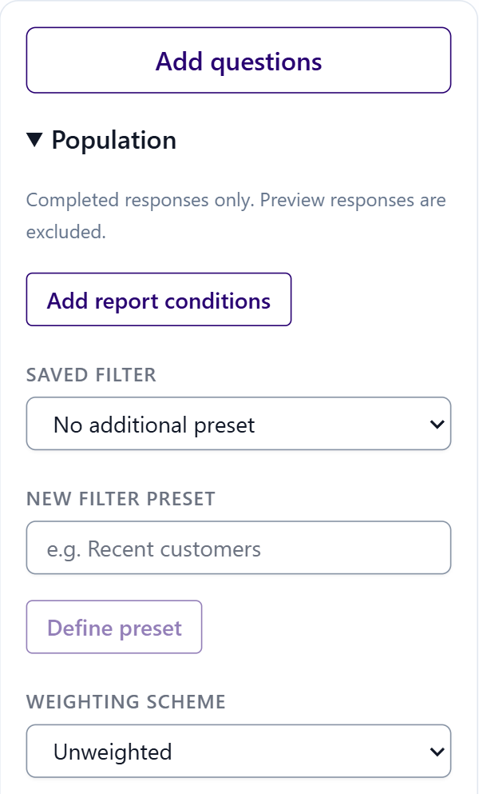
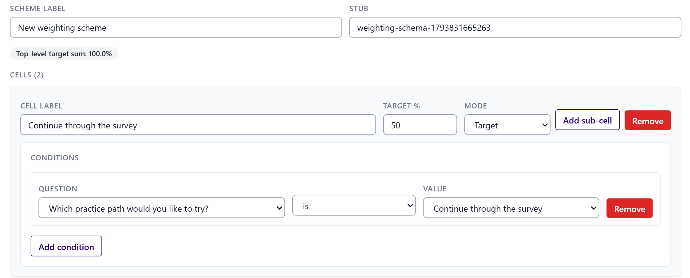

Report filters, comparisons, and weights help analysts define whose results are shown and how they are compared.

{/* Available with */}
{/* Let Q-bit do it */}

Analysts can refine a standard report in its workspace. The starting population is completed, non-preview responses. With no additional filter or weighting selected, the report is unweighted. A population filter narrows the report, while comparison groups show results for groups within that population.

## Set the population

Open **Population** and define conditions with AND/OR groups to narrow the report, then choose **Use conditions**. You can save a named filter preset and select it under **Saved filter**. **No additional preset** leaves that preset unset. A chart can also have its own conditions within the report population. Check the completed base and the in-report population shown in the workspace after applying changes.

## Add weights and comparisons

Select a saved **Weighting scheme** or **Unweighted**. The picker includes inactive schemes. Standard Reports calculate weights from top-level **Target** cells in the filtered population. Fixed cells and sub-cells are ignored. If a scheme is missing, check that it was saved for this survey. See [weighting schemes](./manage-weighting-schemes).

Under **Group source**, choose **Answers to a question** or **Custom conditions**. For a question, choose a **Comparison question** and its groups. For numeric comparisons, set bands. The lower bound is included and the upper bound is excluded, except for the final upper bound; a blank bound is open. For multi-select answers, **Every selected group (overlap)** lets a response appear in more than one group. **First selected group (legacy)** assigns it to the first selected group instead.

For custom conditions, name and define each group. An empty condition includes everyone. Up to 24 custom groups can be configured. Under **Presentation**, choose **Together where supported** or **Separate charts**. Individual charts can override the presentation. Choose **Apply changes**, inspect the bases and missing values, and **Save** the definition.

For example, comparing regions within respondents who completed a survey gives each displayed region its own base. Overlapping multi-select groups should not be added together as though they were mutually exclusive. Experiment models use the applied report population and weights; selecting comparison groups does not refit the model.
