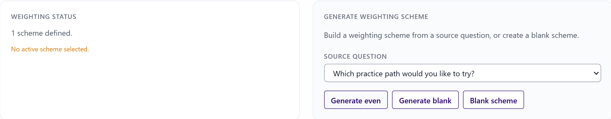

A weighting scheme defines target cells used to adjust results when it is applied to a report.

{/* Available with */}
{/* Let Q-bit do it */}

## When to use it

Use a weighting scheme when reported results need to reflect agreed population targets. For example, if a study's completed respondents do not match its regional targets, define regional cells before reviewing weighted results. Agree on the targets and eligible responses with the research team first. Weighting changes how results are calculated; it does not change the responses collected.

Open the survey's **Weightings** area to define and manage schemes.

1. Select an eligible **Source question** and choose **Generate even** to create equal target cells, or **Generate blank** to start with that question's answers and set the targets yourself. Use **Blank scheme** to build the cells manually. Give the scheme a meaningful **Scheme label**.
2. For a Standard Report, add top-level cells with **Mode** set to **Target**. Give each cell a **Cell label**, a **Target %**, and membership conditions. Check that the target percentages total 100% and review whether responses could match several cells or none.
3. Save the scheme. **Activate** and **Deactivate** change the survey's activation status for that scheme. Standard Reports list saved schemes regardless of that status.
4. Open a standard report and select the scheme under **Weighting scheme**, then **Apply changes** and inspect the weighted results and bases.

## How Standard Reports calculate weights

The editor lets you save **Fixed** cells and sub-cells. Standard Reports ignore those cells and calculate weights using top-level **Target** cells. A scheme with no supported target cells produces unweighted results.

The report assigns a response to the first matching target cell. A response that matches none keeps a weight of 1. Review the report's weighting messages for empty target cells and unmatched responses. Filtering changes the population used for weighting, so review the weighted results and bases again after changing a filter.

Choose **Unweighted** to leave weights off. If a scheme is missing from the picker, check that it was saved for this survey.
