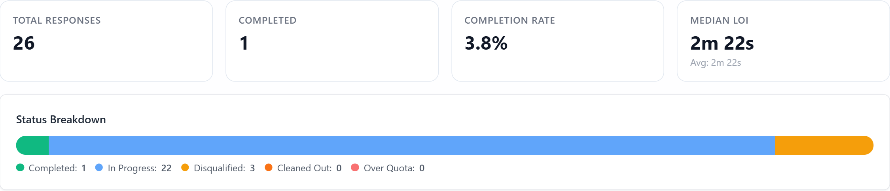

Fielding statistics show survey activity and quota progress so fieldwork staff can monitor collection.

{/* Available with */}
{/* Let Q-bit do it */}

1. Open the survey.
2. Select **Fielding Stats**.
3. Review response totals alongside the survey's quotas and collection dates. For example, compare quota fill with the target and enforcement settings before deciding whether further recruitment is needed.

The summary shows starts, **Completed**, **Completion Rate**, and **Median LOI** (length of interview), with average duration when available. **Status Breakdown** separates completed, in-progress, and other outcome statuses. The trend chart shows started and completed counts by date. **Quota Fill** shows each configured target, current count, and fill percentage.

Compare a percentage with its displayed base before drawing a conclusion. A quota can show more than its target when it continues tracking after the target is reached. Open [survey quotas](../fieldwork/set-and-monitor-quotas) to inspect the rule and its enforcement settings. For an individual response, use [Responses](./review-survey-responses).

If a chart has no data yet, check that the survey has received responses and refresh the view. For a first test, open **Responses** to inspect the recorded answer and distinguish a **Preview** response from a respondent-link response. A fieldwork count and a report population can differ because they describe different sets of responses.

## Find results

- To see how many people have started or finished, review **Fielding Stats**.
- To see what one respondent submitted, open [Responses](./review-survey-responses).
- To chart results, [create a standard report](./create-standard-report).
- To download response rows, [export responses](./export-responses).
