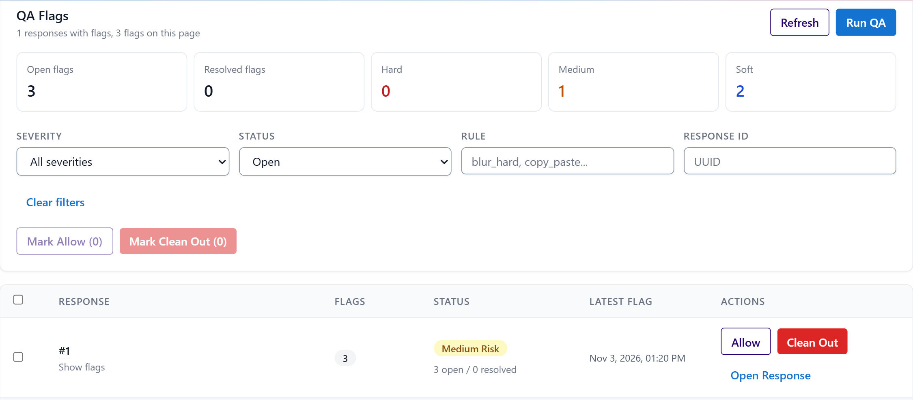

Quality flags identify response indicators for a reviewer to investigate in context.

{/* Available with */}
{/* Let Q-bit do it */}

Quality reviewers can use a survey's **QA Flags** to examine those indicators and record a decision. A flag is a reason to review the available context. It does not establish fraud on its own.

1. Open the survey's **QA Flags** tab and choose **Run QA** to request an evaluation. Use **Refresh** to reload the list.
2. Filter by **Severity**, **Status**, **Rule**, or **Response ID**. The initial status filter is **Open**. Clear or change it to inspect resolved flags.
3. Expand a respondent to see grouped flags, their severity, status, notes, and decision. Use **Open Response** to inspect the response and its recorded context.
4. Select the flags you have reviewed and choose **Mark Allow** or **Mark Clean Out** as appropriate. Review the selection before applying a decision.

The summary tiles describe the flags on the visible page. Check the filters and page before treating a tile as a survey-wide total. If no flags appear, check the selected status and filters, run QA when appropriate, and refresh.

An optional bot-check question is a separate challenge and signal. A failed challenge or a behavioural indicator is not, by itself, a fraud verdict. Administrators can [configure quality rules](./configure-quality-rules); review the rule and response context before deciding.

For example, a fast-answer flag may warrant checking the answer and its context before choosing **Mark Allow** or **Mark Clean Out**. Use the survey's review process when deciding how to handle it.
