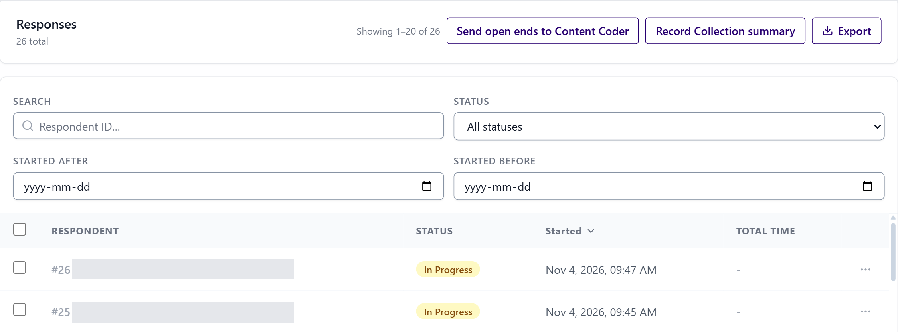
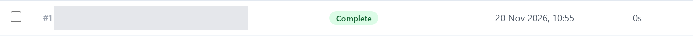
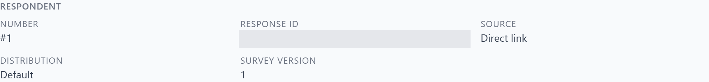
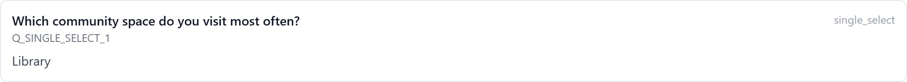

Review survey responses to inspect individual answers, status, and recorded context.

{/* Available with */}
{/* Let Q-bit do it */}

Research staff can open the survey and select **Responses**. Use this view to investigate an individual response; use an export for a data file or a report for calculated results across a population.

## Find and inspect a response

1. Open the survey and select **Responses**.
2. Use **Search**, **Status**, and the start-date fields to narrow the list. Select **Clear filters** to return to the full list.
3. Sort using a sortable column heading, or move between pages. The page-size control offers 20, 50, or 100 rows.
4. Select a response row or respondent number to open **Response details**.
5. Check its status, source, timestamps, duration, device and location details when available, and recorded answers. Record Collection entries and experiment tasks appear when present.
6. Close the detail panel to return to the list.

A response with a complete status shows **Complete**. A response from a survey preview also has a **Preview** badge. If a response is missing, clear the filters, check the status and start dates, and refresh the view. For a direct-link test, check that you used the respondent URL rather than the preview URL.

## Change a status or delete

Use the row action menu to set a status or choose **Delete response**. For several responses, select the rows on the current page, then use **Change status** or **Delete**. Check the selection and confirmation before deleting. The select-all checkbox applies to the current page, not every matching response.

Status changes can affect downstream analysis. Investigate suspicious responses using [QA Flags](./review-quality-flags) before making a decision. To download records for further work, [export responses](./export-responses).
