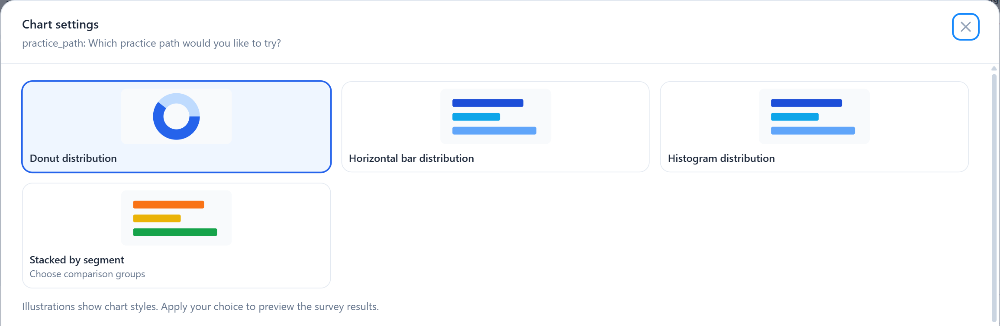

Standard report chart types present different kinds of survey results for comparison and interpretation.

{/* Available with */}
{/* Let Q-bit do it */}

The chart chooser offers visualisations suited to the selected survey question and available results. For example, use a distribution to inspect answer patterns or a trend to see results over time where offered. The options depend on the question type and the supported charts for your survey.

| Question or data | Examples of report views |
| --- | --- |
| Written answer | Word cloud and response-length distribution. |
| Numeric or derived age | Numeric KPIs, histogram, mean by segment, and trend. |
| Single choice | Donut, horizontal bar, histogram, and stacked results by segment. |
| Multi-choice | Selection rate, selection histogram, stacked results by segment, and segment heatmap. |
| Scale | Distribution, histogram, KPIs, and trend. |
| Rating grid | Distribution, top-box by row, and row mean heatmap. |
| Brand Affinity | Master table, map, top or bottom effective affinity, hidden gems, and sentiment composition. |
| Slider, slider list, continuous sum, or semantic differential | Spectra, distributions, KPIs, or trends as supported by the question. |
| Rank | Summary, distribution, and heatmap. |
| MaxDiff or conjoint | Experiment summaries and model results. See [experiment results](./interpret-experiment-results). |

## Read rating-grid and ranking charts

**Top-box by row** uses the last configured rating-grid answer column or answer group. Its base is the recorded ratings for that row. If the final category is **Don't know**, the chart counts it as the top box. Check the category order or use the grid distribution to see all answers.

In a Rank distribution or heatmap, the percentage for a place uses the respondents who ranked that item. If 10 of the 20 respondents who ranked Library placed it first, Library's unweighted first-place share is 50% among those 20. Check the population and any weighting before comparing items.

Check the chart title, filters, weighting, displayed base, and any missing values before comparing results. [Choose and download report charts](./choose-and-download-report-charts) to configure and export an individual result.
