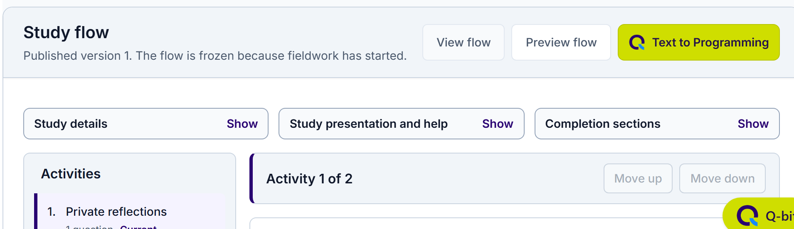
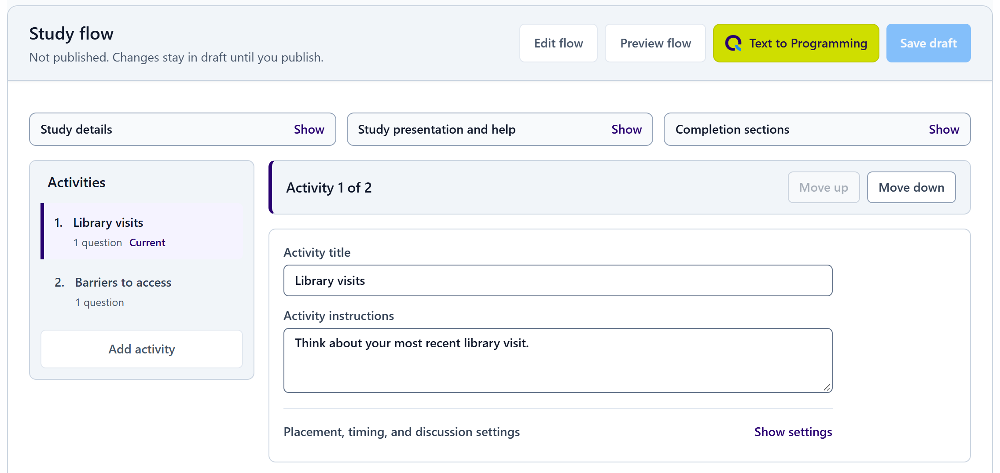

A study flow organises the activities, questions, and presentation participants encounter in a Bulletin Board. Open the study, select **Study flow**, and choose **Edit flow** to prepare it.

{/* Available with */}
{/* Let Q-bit do it */}

1. Open **Study details** to enter a title and introduction. Under **Study presentation and help**, set the brand, optional logo, accent, help contact, and welcome or completion wording. A blank wording field uses the standard wording.
2. Choose **Add activity**. Enter its title and instructions, then choose **Private questions** or **Discussion** under **Placement, timing, and discussion settings**. Add participant content and questions.
3. Use **Move up** and **Move down** to order activities. An optional day or group heading organises the study home. It does not set a release time. An estimate helps participants plan but does not limit their time. Earlier required activities affect progression. A discussion also needs staff release.
4. If adjacent activities should be submitted together, open **Completion sections** and choose **Add completion section**. For each activity, open **Placement, timing, and discussion settings** and select the section under **Completion section**. Participants can move back and next while editing, then submit the section together. Unassign activities before removing their section.
5. Choose **Save draft**, then **Preview flow**. Review the participant wording and order, and fix any listed issues before publishing. Staff preview does not create participant answers.

   

For example, group two adjacent private-question activities in one completion section. Add a written question to an earlier activity and a later discussion activity. Participants submit the two private screens together, then can enter the discussion after required progression and staff release. Preview the content and order, then test the grouped submission in a participant journey.

For discussion activities, choose the required number of replies from 0 to 10. Zero makes replies optional. Choose whether required replies count by different comments or different people, and whether further replies to a comment are allowed. Select and [release participant-visible contributions](./curate-and-moderate-discussion) separately after people submit written answers. See [publish, open, and close a study](./publish-open-and-close).

## Related tasks

- [Add Bulletin Board questions and content](./add-questions-and-content)
