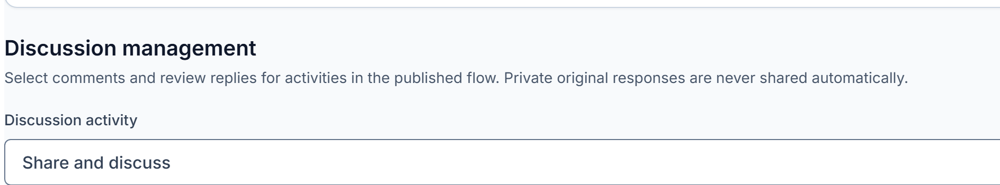

Discussion curation prepares participant-visible contributions from submitted written responses. Open **Discussion** in a study with a published discussion activity and select that activity. Original answers are not shared automatically with other participants. The research team and authorised client observers can view submitted answers.

{/* Available with */}
{/* Let Q-bit do it */}

## Prepare and release contributions

1. Under **Private submitted responses**, select eligible written answers from earlier activities. **Find loaded responses** searches only loaded material. Choose **Load more submitted responses** when available to include more. Prepare a participant-visible alias and text for each contribution, removing identifying details while preserving meaning.
2. Choose **Save curation draft**, then **Review release**. Inspect the participant preview and **Release checks**. Ensure participants can meet the configured reply requirement.
3. Choose **Release discussion**. Saving the draft alone does not release it.

## Review replies

In **Reply review**, choose a reply and compare its private original with the proposed public alias and text. Remove identifying details while preserving the participant's meaning, including disagreement. Choose **Review public reply**, inspect the public copy, then choose **Publish reply**. To withhold it, choose **Withhold reply** and confirm. Withholding does not remove earned completion.

For example, prepare participant-visible wording from a private answer using an alias and removing identifying details, review it in the participant preview, and release it only after the checks pass. A saved curation draft remains private until release. A submitted answer, a released excerpt, and a published reply are separate records with different audiences.

If participants must reply to two different people and those authors also participate, select contributions from at least three distinct authors. Check the authors as well as the release checks. Multiple excerpts from one person do not provide different people for the requirement.

Before choosing **Withdraw release**, consider that the release cannot be reopened, unfinished participants may be blocked from progressing, and a snapshot containing the discussion may become unavailable. To withdraw, choose **Withdraw release** and confirm. This hides the discussion and prevents new replies. Responses and replies remain recorded, and earned completion is retained. If an operation is unconfirmed, retry the same reviewed operation. If the study changed, refresh and review again.

## Related tasks

- [Participate in a Bulletin Board discussion](./participate-in-discussion)
- [Publish, open, and close a Bulletin Board](./publish-open-and-close)
- [Snapshot and export study data](./snapshot-and-export-study-data)
