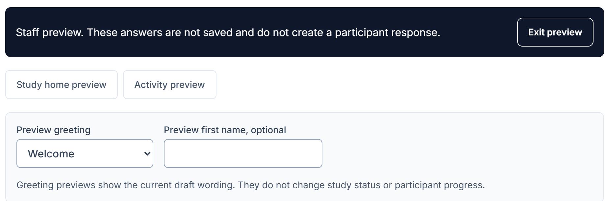

A saved flow import lets you review a validated Bulletin Board setup and replace the current draft after confirmation. Open **Study flow**, expand **Import a saved flow**, and select a Bulletin Board JSON file. The file must be no larger than 500 KB.

{/* Available with */}
{/* Let Q-bit do it */}

The file is validated before it reaches the editor. Review the proposed replacement and choose **Replace draft** only if you want to replace the current flow on the page. Unsaved changes to that flow will be replaced. Choose **Keep current draft** to cancel. An import does not save, publish, or open the study.

For example, import a saved flow into a new study, inspect the activities and wording, and save only after confirming they fit the new study. The replacement affects the current draft; publication remains a separate action.

Choose **Save draft** after reviewing the imported activities. Then choose **Preview flow**. Use **Study home preview** to check welcome, returning, and completed greetings, or **Activity preview** to try questions and conditions. Preview answers are not saved and do not create participant responses. The preview does not show released discussion.

Choose **Exit preview** to return to editing. Fix any listed validation issues before saving or publishing. If the file is invalid, correct it and select it again.

## Related tasks

- [Build the study flow](./build-the-study-flow)
- [Publish, open, and close a study](./publish-open-and-close)
