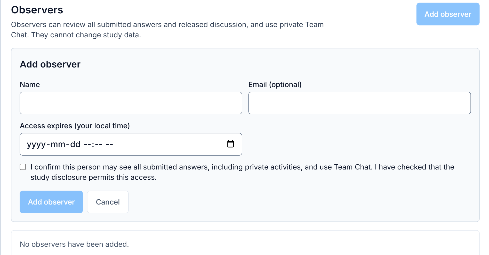
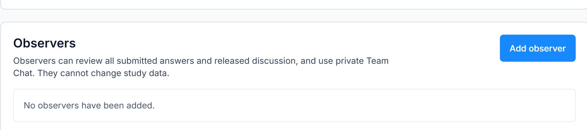

Observers can review published activities and submitted answers without changing study data. They can also use a separate Team Chat shared with assigned Observers and authorised research staff. Before adding an Observer, confirm that the study disclosure permits this access and that the person may see all submitted answers, including answers to private activities. Written answers may identify a participant even when a pseudonym is displayed.

{/* Available with */}
{/* Let Q-bit do it */}

## Add and invite an Observer

1. Open the study, choose **People**, and go to **Observer access**. Choose **Add observer**.
2. Enter the person's name, optional email, and **Access expires (your local time)**. Choose an expiry in the future, within 365 days. Confirm the access and disclosure statement, then choose **Add observer**. Adding access does not send an invitation.
3. To share a link yourself, choose **Personal link**, then **Copy link**. Share it only with that Observer. The link gives access to submitted answers and Team Chat.
4. To email the link, the study Flow must be published and the Observer needs an email address. Choose **Invite**, review the subject and message, and confirm permission to contact them. Choose **Review invitation**, inspect the recipient, sender, reply-to, eligibility, and preview, then choose **Send reviewed invitation**. Preview links are inactive.
5. Check **Delivery history** in **Messages** for the result. Queued means waiting for delivery; sent does not mean the invitation was read.

Observers can review submitted answers and released discussion after the Flow is published. Draft answers, contact details, and research-team private records are excluded. Team Chat is shared among assigned Observers and authorised research staff; participants cannot access it.

An existing email suppression blocks delivery to that address. Confirming contact permission does not override it. Eligibility is checked again before delivery. If a request is unconfirmed, use **Retry the same request** before making another change.

## Revoke access

Under **Observers**, choose **Revoke access** for the person and confirm. Their personal link stops working. Revoking access does not itself delete Team Chat history. Access also ends at the chosen expiry, or when the study or project is archived or contacts are erased. A closed study may remain available until then, subject to the study's retention settings.

## Related tasks

- [Review a study as an Observer](./review-a-study-as-an-observer)
- [Enrol people and manage study access](./manage-study-people)
