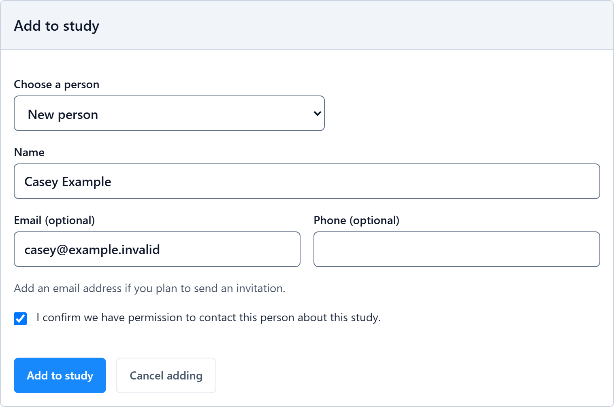

The study roster gives enrolled people access to a Bulletin Board and shows their progress. Open the study and choose **People**. Adding a person gives them study access; it does not send an invitation.

{/* Available with */}
{/* Let Q-bit do it */}

1. Choose **Add people**. Under **Choose a person**, select **Existing person in this session group** or **New person**.
2. Search for and select an existing person, or enter the new person's name and contact details. Add an email address if you plan to send an email invitation.
3. Confirm that you have permission to contact the person about the study, then choose **Add to study**. Check that the person appears in the **Study roster**.

   

4. To share an individual link, choose **Personal link**, then **Copy personal link**. Give it only to that person. To send an invitation instead, open **Messages** and [review the email](./send-study-email).

For example, after adding a person, review their roster entry and send their personal invitation through **Messages** when the study is ready. Adding them to the roster alone does not send it.

To stop access, choose **Revoke access** and confirm. The current link stops working while saved responses are kept. To restore an eligible person's access, choose **Add people**, find them under **Existing person in this session group**, and select **Restore study access**. This creates a new personal link; old revoked links remain unavailable. Some people are managed by Registration, so follow their Registration workflow when shown.

If an access change is unconfirmed, use the displayed retry for that same change. If access changed while you were working, choose **Refresh people** and review the current record before trying again.

Observers use separate access from participants. See [Manage Observer access](./manage-observer-access) to add or revoke an Observer and review what they can see.

## Related tasks

- [Set participant contact requirements](./set-contact-requirements)
- [Send Bulletin Board invitations and reminders](./send-study-email)
- [Participate in a Bulletin Board study](./participate-in-a-study)
- [Manage Observer access](./manage-observer-access)
